<p align="center">
  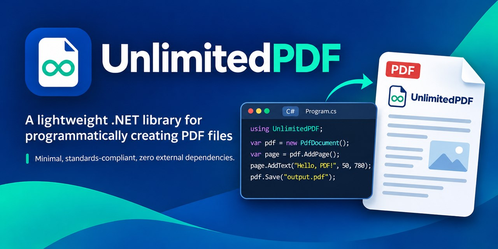
</p>

<h3 align="center">UnlimitedPDF Library</h3>

<p align="center">
A free, open-source, pure .NET PDF library for C#: create PDFs with text, tables, images, headers, and footers; merge, split, and extract or remove pages of existing PDFs; and convert HTML to PDF, saved to a file or a stream.
</p>

<p align="center">
✓ Free and open source · ✓ .NET 6 to 11 · ✓ No PDF engine or native code
</p>

<p align="center">
<a href="https://www.nuget.org/packages/UnlimitedPDF"></a>
<a href="https://www.nuget.org/packages/UnlimitedPDF"></a>
<a href="LICENSE"></a>
</p>

<p align="center">
<a href="https://unlimitedpdf.dev/"><b>Live demos</b></a> ·
<a href="docs/guides/README.md"><b>Guides</b></a> ·
<a href="#benchmarks"><b>Benchmarks</b></a> ·
<a href="CHANGELOG.md"><b>Changelog</b></a>
</p>

## Install

- .NET CLI: `dotnet add package UnlimitedPDF --version 1.2.0`
- Package reference: `<PackageReference Include="UnlimitedPDF" Version="1.2.0" />`

One package for `net6.0` to `net11.0`, with no third-party dependencies.

## Quick start

<table>
<tr>
<td>

```cs
using UnlimitedPDF;

var pdfDocument = new PdfDocument();

var page1 = pdfDocument.AddPage();
page1.AddText("UnlimitedPDF library - Sample PDF", 50, 750, 24);
page1.AddText("This is the first line on the first page.", 50, 730, 12);
page1.AddText("This is the second line on the first page.", 50, 710, 12);

pdfDocument.Save("unlimited-pdf-sample.pdf");
```

</td>
<td width="280"></td>
</tr>
</table>

## What it does

| Capability | What you get | Guide | Try it |
|---|---|---|---|
| Create PDFs | Text at any position, tables with colors, borders, and spans, page sizes | [Create PDFs](docs/guides/create-pdfs.md) | [Demo](https://unlimitedpdf.dev/playground/create/text-and-pages) |
| Images | JPEG and PNG, fit modes, images in table cells, each image stored once | [Add images](docs/guides/images.md) | [Demo](https://unlimitedpdf.dev/playground/create/images) |
| Tables across pages | Long tables continue on new pages, with header rows repeated | [Tables across pages](docs/guides/tables-across-pages.md) | [Demo](https://unlimitedpdf.dev/playground/create/tables) |
| Headers, footers & flow | Page numbers, first, last, odd, and even page settings, content that flows across pages | [Headers, footers & flow](docs/guides/headers-footers-and-flow.md) | [Demo](https://unlimitedpdf.dev/playground/create/headers-and-footers) |
| Merge PDFs | Join whole files or page ranges, keeping bookmarks, links, and comments | [Merge PDFs](docs/guides/merge-pdfs.md) | [Demo](https://unlimitedpdf.dev/playground/merge/join-files) |
| Split PDFs | Every N pages or by page range, to a folder or to streams | [Split PDFs](docs/guides/split-pdfs.md) | [Demo](https://unlimitedpdf.dev/playground/split/every-n-pages) |
| Extract and remove pages | The pages you choose, in your order, or a PDF without them | [Extract and remove pages](docs/guides/extract-and-remove-pages.md) | [Demo](https://unlimitedpdf.dev/playground/split/extract-pages) |
| HTML to PDF | HTML and CSS drawn by the library's own renderer: no browser, no network | [HTML to PDF](docs/guides/html-to-pdf.md) | [Demo](https://unlimitedpdf.dev/playground/html/html-to-pdf) |
| Fonts and languages | Your own fonts for 17 scripts, from Latin and Hindi to Arabic and Hebrew, and documents that read right to left | [Fonts and languages](docs/guides/fonts-and-languages.md) | [Demo](https://unlimitedpdf.dev/playground/languages/fonts-and-languages) |

## Screenshots

PDFs made by the live demos. Select one to open its guide.

<table>
<tr>
<td align="center"><a href="docs/guides/create-pdfs.md">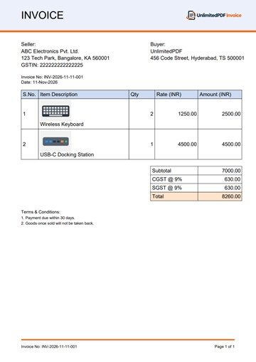</a><br /><sub>Invoice</sub></td>
<td align="center"><a href="docs/guides/create-pdfs.md">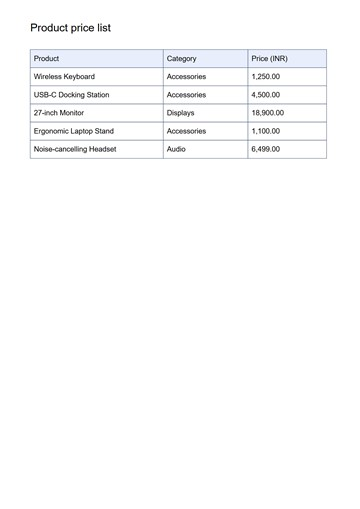</a><br /><sub>Tables</sub></td>
<td align="center"><a href="docs/guides/images.md">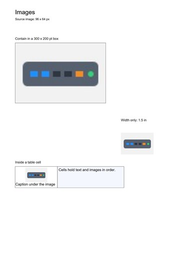</a><br /><sub>Images</sub></td>
<td align="center"><a href="docs/guides/headers-footers-and-flow.md">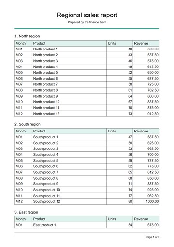</a><br /><sub>Headers and footers</sub></td>
<td align="center"><a href="docs/guides/merge-pdfs.md">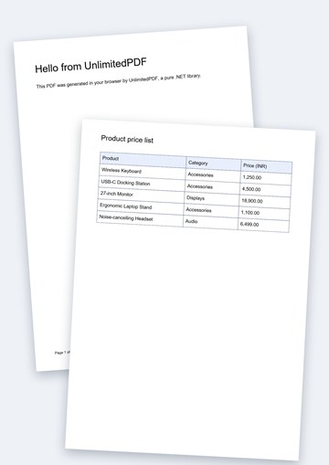</a><br /><sub>Merge</sub></td>
</tr>
<tr>
<td align="center"><a href="docs/guides/split-pdfs.md">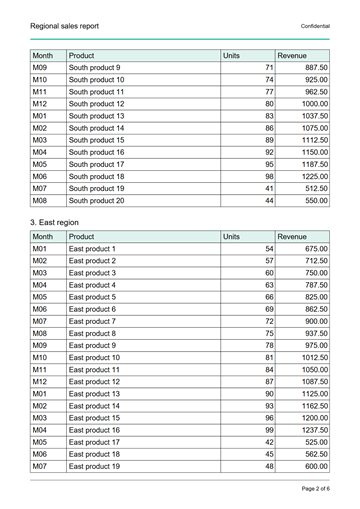</a><br /><sub>Split</sub></td>
<td align="center"><a href="docs/guides/extract-and-remove-pages.md">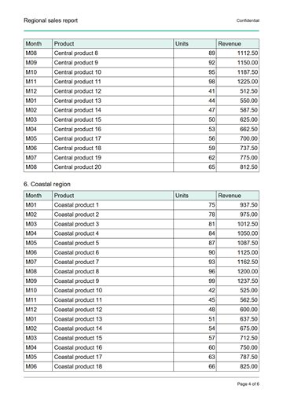</a><br /><sub>Extract pages</sub></td>
<td align="center"><a href="docs/guides/html-to-pdf.md">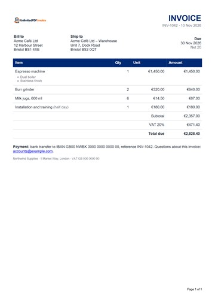</a><br /><sub>HTML to PDF</sub></td>
<td align="center"><a href="docs/guides/fonts-and-languages.md">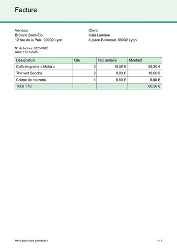</a><br /><sub>Fonts and languages</sub></td>
<td align="center"><a href="docs/guides/fonts-and-languages.md">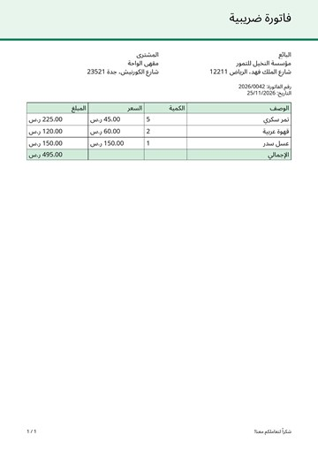</a><br /><sub>Right to left</sub></td>
</tr>
</table>

## Benchmarks

Measured with BenchmarkDotNet in [unlimitedpdf-benchmarks](https://github.com/unlimited-docs/unlimitedpdf-benchmarks), which checks every PDF before timing it. The results are informational: they come from one developer desktop that was not isolated. **Ratio** is the other library's mean time divided by UnlimitedPDF's: above 1, UnlimitedPDF was faster; below 1, it was slower.

### 1.1.0

Run on 2026-11-25 with .NET 10.0.14, an Intel Core i5-9400F, and Windows 11. [Full results](https://github.com/unlimited-docs/unlimitedpdf-benchmarks/blob/main/docs/results/2026-11-25-windows-i5-9400f.md), with memory and more scenarios.

| Scenario | UnlimitedPDF | Compared with | Their time | Ratio |
|---|---:|---|---:|---:|
| Invoice | 3.6 ms | MigraDoc 6.2.4 | 4.45 ms | 1.24 |
| Table, 1,000 rows | 106 ms | MigraDoc 6.2.4 | 162 ms | 1.52 |
| Table with images, 100 rows | 12.2 ms | MigraDoc 6.2.4 | 36.5 ms | 2.99 |
| One PNG image | 1.33 ms | PDFsharp 6.2.4 | 8.19 ms | 6.17 |
| Merge 100 documents | 17.5 ms | PDFsharp 6.2.4 | 29.2 ms | 1.67 |
| Split 1,000 pages into single pages | 170 ms | PDFsharp 6.2.4 | 188 ms | 1.10 |
| Text in an embedded font, 100 pages | 486 ms | PDFsharp 6.2.4 | 24.6 ms | 0.05 |
| Headers, footers, and page numbers, 1,000 pages | 3.51 s | MigraDoc 6.2.4 | 1.35 s | 0.39 |
| Hindi text, 100 pages | 2.88 s | SkiaSharp 4.157.0 | 187 ms | 0.06 |
| HTML to PDF, 1 page | 4.6 ms | none of the compared libraries converts HTML | | |

## What's new in 1.2.0

- Right-to-left documents in Arabic, Persian, Urdu, Hebrew, Dhivehi, and more: numbers and English words stay in place, tables start at the right, and HTML follows `dir`.
- Ten more scripts: Bengali-Assamese, Gujarati, Gurmukhi, Odia, Kannada, Malayalam, Greek, Cyrillic, Armenian, and Georgian.
- `Start` and `End` alignment, with `Start` as the default; left-to-right text draws as before.

Every change is in the [changelog](CHANGELOG.md). Upgrading from 0.0.x? See [Upgrading to 1.0.0](docs/guides/upgrading-to-1.0.0.md).

## Contributing

Contributions are welcome. See [CONTRIBUTING.md](CONTRIBUTING.md) for how to open a pull request. Every contributor signs the [Contributor License Agreement](CLA.md) once, on their first pull request.
