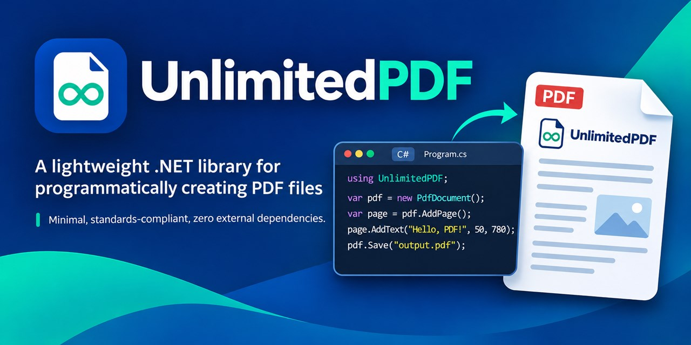

<p align="center">
  
</p>

<h3 align="center">UnlimitedPDF Library</h3>

<p align="center">
UnlimitedPDF is an enterprise-grade, pure .NET PDF library for creating PDF documents with text, tables, and JPEG and PNG images, saved to a file or a stream.
</p>

## Status

[](https://www.nuget.org/packages/unlimitedpdf/absoluteLatest)
[](https://www.nuget.org/packages/unlimitedpdf/absoluteLatest)

## Table of contents

### [Install](#install)

- **.NET CLI**
  
  Install with [NuGet](https://www.nuget.org/): `dotnet add package UnlimitedPDF --version 0.1.0`
  
- **Package Reference**
  
  Add package reference to project: `<PackageReference Include="UnlimitedPDF" Version="0.1.0" />`

## Demos

`UnlimitedPDF.Demos.BlazorWasm` is an interactive playground that runs entirely in the browser. It generates PDFs for text and pages, tables, images, and headers and footers, plus complete business documents: invoice, quotation, purchase order, delivery note, account statement, payslip, medical report, receipt, certificate, and employee directory. Each demo has editable options, a live preview, a download, and the C# code that builds it.

Run it locally:

```bash
dotnet run --project UnlimitedPDF.Demos.BlazorWasm
```

## Sample Code

```cs

var pdfFilePath = @"D:\\unlimited-pdf-sample.pdf";

var pdfDocument = new PdfDocument();

// Add the first page and add content to it.
var page1 = pdfDocument.AddPage();
page1.AddText("UnlimitedPDF library - Sample PDF", 50, 750, 24);
page1.AddText("This is the first line on the first page.", 50, 730, 12);
page1.AddText("This is the second line on the first page.", 50, 710, 12);

pdfDocument.Save(pdfFilePath);
```

### Screenshot


## Create a sample invoice

```cs
using UnlimitedPDF;
using UnlimitedPDF.Enums;
using UnlimitedPDF.Models.Table;

Console.WriteLine("Start: Unlimited PDF");

var pdfFilePath = @"D:\\unlimited-pdf-sample.pdf";

// Use a 'using' statement for proper resource management with IDisposable
var pdfDocument = new PdfDocument();

// --- Page 1: Invoice ---
var page1 = pdfDocument.AddPage();

// 1. Invoice Header
page1.AddText("INVOICE", 250, 800, 20);

// Seller and Buyer Details
page1.AddText("Seller:", 50, 760, 10);
page1.AddText("ABC Electronics Pvt. Ltd.", 50, 748, 10);
page1.AddText("123 Tech Park, Bangalore, KA 560001", 50, 736, 10);
page1.AddText("GSTIN: 222222222222225", 50, 724, 10);

page1.AddText("Buyer:", 350, 760, 10);
page1.AddText("UnlimitedPDF", 350, 748, 10);
page1.AddText("456 Code Street, Hyderabad, TS 500001", 350, 736, 10);

// Invoice Metadata
page1.AddText($"Invoice No: INV-{DateTime.Now:yyyy-MM-dd}-001", 50, 690, 10);
page1.AddText($"Date: {DateTime.Now:dd-MMM-yyyy}", 50, 678, 10);

// 2. Items Table
var itemsTable = page1.AddTable(50, 650, 512);
itemsTable.SetColumnWidths(40, 210, 60, 100, 102);

// Table Headers
var headerRow = itemsTable.AddRow();
headerRow.GetCell(0).Text = "S.No.";
headerRow.GetCell(0).Background = PdfColor.LightGray;
headerRow.GetCell(1).Text = "Item Description";
headerRow.GetCell(1).Background = PdfColor.LightGray;
headerRow.GetCell(2).Text = "Qty";
headerRow.GetCell(2).Background = PdfColor.LightGray;
headerRow.GetCell(3).Text = "Rate (INR)";
headerRow.GetCell(3).Background = PdfColor.LightGray;
headerRow.GetCell(4).Text = "Amount (INR)";
headerRow.GetCell(4).Background = PdfColor.LightGray;

// Item 1
var item1Row = itemsTable.AddRow();
item1Row.GetCell(0).Text = "1";
item1Row.GetCell(1).Text = "Wireless Keyboard";
item1Row.GetCell(2).Text = "2";
item1Row.GetCell(2).HAlign = PdfCellHorizontalAlignment.Right;
item1Row.GetCell(3).Text = "1250.00";
item1Row.GetCell(3).HAlign = PdfCellHorizontalAlignment.Right;
item1Row.GetCell(4).Text = "2500.00";
item1Row.GetCell(4).HAlign = PdfCellHorizontalAlignment.Right;

// Item 2
var item2Row = itemsTable.AddRow();
item2Row.GetCell(0).Text = "2";
item2Row.GetCell(1).Text = "USB-C Docking Station";
item2Row.GetCell(2).Text = "1";
item2Row.GetCell(2).HAlign = PdfCellHorizontalAlignment.Right;
item2Row.GetCell(3).Text = "4500.00";
item2Row.GetCell(3).HAlign = PdfCellHorizontalAlignment.Right;
item2Row.GetCell(4).Text = "4500.00";
item2Row.GetCell(4).HAlign = PdfCellHorizontalAlignment.Right;

// 3. Totals Section
double subtotal = 7000.00;
double cgst = subtotal * 0.09; // 9% CGST
double sgst = subtotal * 0.09; // 9% SGST
double total = subtotal + cgst + sgst;

var totalsTable = page1.AddTable(350, 550, 212);
totalsTable.SetColumnWidths(110, 102);

totalsTable.GetOrCreateCell(0, 0).Text = "Subtotal";
var subtotalValueCell = totalsTable.GetOrCreateCell(0, 1);
subtotalValueCell.Text = subtotal.ToString("F2");
subtotalValueCell.HAlign = PdfCellHorizontalAlignment.Right;

totalsTable.GetOrCreateCell(1, 0).Text = "CGST @ 9%";
var cgstValueCell = totalsTable.GetOrCreateCell(1, 1);
cgstValueCell.Text = cgst.ToString("F2");
cgstValueCell.HAlign = PdfCellHorizontalAlignment.Right;

totalsTable.GetOrCreateCell(2, 0).Text = "SGST @ 9%";
var sgstValueCell = totalsTable.GetOrCreateCell(2, 1);
sgstValueCell.Text = sgst.ToString("F2");
sgstValueCell.HAlign = PdfCellHorizontalAlignment.Right;

var totalCell = totalsTable.GetOrCreateCell(3, 0);
totalCell.Text = "Total";
totalCell.Background = PdfColor.LightGray;

var totalValueCell = totalsTable.GetOrCreateCell(3, 1);
totalValueCell.Text = total.ToString("F2");
totalValueCell.HAlign = PdfCellHorizontalAlignment.Right;
totalValueCell.Background = PdfColor.LightGray;

// 4. Terms and Conditions
page1.AddText("Terms & Conditions:", 50, 450, 10);
page1.AddText("1. Payment due within 30 days.", 50, 438, 9);
page1.AddText("2. Goods once sold will not be taken back.", 50, 426, 9);

pdfDocument.Save(pdfFilePath);

Console.WriteLine("End: Unlimited PDF");
Console.ReadLine();
```

### Screenshot


## Add images

Load a JPEG or PNG once, then place it anywhere on any page, or inside table cells. Each image is stored once in the PDF, however many times it is placed, and one loaded image can be shared by many documents, including documents built in parallel.

```cs
using UnlimitedPDF;
using UnlimitedPDF.Enums;
using UnlimitedPDF.Models.Table;

// Load from a file, a Stream, or a byte array; async loading takes a cancellation token.
var logo = PdfImage.FromFile("logo.png");
var photo = await PdfImage.FromStreamAsync(uploadStream);

var pdfDocument = new PdfDocument();
var page = pdfDocument.AddPage();

// x and y are the image's bottom-left corner, in points from the page's bottom-left corner.
// With no size, images draw at 96 pixels per inch; with one size, the other keeps the aspect ratio.
page.AddImage(logo, 492, 762, width: 70);

// With both sizes the image stretches to fill the box, or fits inside it with Contain.
page.AddImage(photo, 50, 560, 150, 100, new PdfImagePlacementOptions { Fit = PdfImageFit.Contain });

// Lengths are always points; convert from millimeters, centimeters, inches, or pixels.
page.AddImage(photo, PdfUnits.FromMillimeters(20), PdfUnits.FromMillimeters(20), width: PdfUnits.FromInches(2));

// A cell holds an ordered list of text and images, drawn top to bottom.
// AtLeast rows grow to fit their content; Exactly rows (the default) keep their height and shrink images.
var table = page.AddTable(50, 500, 300);
table.SetColumnWidths(100, 200);
table.RowHeightRule = PdfRowHeightRule.AtLeast;
table.GetOrCreateCell(0, 0).SetContent(photo, "Laptop", "SKU 123");
table.GetOrCreateCell(0, 1).Text = "Image above two lines of text";

pdfDocument.Save("images.pdf");
```

- Supported formats: JPEG (baseline and progressive; grayscale, RGB, CMYK) and PNG (every color type and bit depth, interlaced or not, with transparency).
- Photos honor their EXIF orientation. Turn this off with `PdfImageLoadOptions.ApplyExifOrientation = false`.
- Bad input fails at load. Unsupported formats, damaged data, and images over the pixel limit throw `PdfImageException`. The limit is 100,000,000 pixels by default; change it with `PdfImageLoadOptions.MaxPixels` or `PdfImage.DefaultMaxPixels`.

## Tables across pages

A table that runs past the bottom of the page continues on a new page by itself. Rows are never split, and the new pages are added right after the table's page.

```cs
using UnlimitedPDF;
using UnlimitedPDF.Models.Table;

// Margins apply to every page; both default to 0 (the page edges).
var pdfDocument = new PdfDocument { TopMargin = 40, BottomMargin = 50 };
var page = pdfDocument.AddPage();

var table = page.AddTable(40, 760, 515);
table.SetColumnWidths(60, 255, 200);

// Mark the first row as a header and draw it again at the top of every new page.
table.HeaderRowCount = 1;
table.RepeatHeaderRows = true;
table.GetOrCreateCell(0, 0).Text = "No.";
table.GetOrCreateCell(0, 1).Text = "Name";
table.GetOrCreateCell(0, 2).Text = "Department";

for (int i = 1; i <= 200; i++)
{
    table.GetOrCreateCell(i, 0).Text = i.ToString();
    table.GetOrCreateCell(i, 1).Text = "Employee " + i;
    table.GetOrCreateCell(i, 2).Text = "Engineering";
}

pdfDocument.Save("directory.pdf");
```

- A row taller than the space between the margins, or header rows that cannot fit with one data row, make `Save` throw before anything is written.
- Tables that start on the same page share their continuation pages, so side-by-side tables stay side by side.
- Content you place at coordinates is never moved. To put content after a table, add both to the body flow (see [Headers, footers & flow](#headers-footers--flow)).

## Headers, footers & flow

Give every page a header and a footer, and let body content flow from page to page. Each body item stacks below the previous one, and the library adds pages as the content needs them.

```cs
using UnlimitedPDF;
using UnlimitedPDF.Enums;
using UnlimitedPDF.Models.Table;

var pdfDocument = new PdfDocument { TopMargin = 30, BottomMargin = 30, LeftMargin = 40, RightMargin = 40 };

// Drawn on every page. Offsets are measured from the band's top-left corner; content past the band is clipped.
pdfDocument.Header.Height = 40;
pdfDocument.Header.AddText("Quarterly report", 0, 8, 14);
pdfDocument.Header.AddRectangle(0, 36, 515, 1, PdfColor.Black);
pdfDocument.Footer.Height = 20;
pdfDocument.Footer.AddText("Page {page} of {pages}", 0, 4, 9, PdfTextAlignment.Right);

// The first page gets its own, taller header.
var first = pdfDocument.AddPageRule(PdfPageRuleTarget.First);
first.Header.Height = 70;
first.Header.AddText("Quarterly report", 0, 10, 24, PdfTextAlignment.Center);

// Body items stack below each other with a spacing and continue on new pages by themselves.
var body = pdfDocument.Body;
body.TopGap = 12;
body.AddText("Employees", fontSize: 14, keepWithNext: true);

var table = body.AddTable(515, spacing: 6);
table.SetColumnWidths(60, 255, 200);
table.HeaderRowCount = 1;
table.RepeatHeaderRows = true;
table.GetOrCreateCell(0, 0).Text = "No.";
table.GetOrCreateCell(0, 1).Text = "Name";
table.GetOrCreateCell(0, 2).Text = "Department";

for (int i = 1; i <= 120; i++)
{
    table.GetOrCreateCell(i, 0).Text = i.ToString();
    table.GetOrCreateCell(i, 1).Text = "Employee " + i;
    table.GetOrCreateCell(i, 2).Text = "Engineering";
}

// A block moves to the next page as one piece, right after the table ends.
var signOff = body.AddBlock(spacing: 20);
signOff.AddRectangle(515, 1, PdfColor.Black);
signOff.AddText("Approved by: ____________________", spacing: 10);

pdfDocument.Save("report.pdf");
```

- `{page}` and `{pages}` show each page's number and the page count; `Header.Build(...)` and `Footer.Build(...)` build the content per page instead.
- Page rules for `First`, `Last`, `Odd`, `Even`, or a page number change a band's height, visibility, or content, the body gaps, or the side margins. A `Last` rule may change content only.
- `keepWithNext` keeps an item, such as a heading, on the page of the item after it. Anything taller than an empty body makes `Save` throw before anything is written.
- `Body.Remaining` is the room left where the next item lands. If what it measured changes afterwards, `Save` throws instead of writing a different layout.
- `Body.MaxPages` caps the page count; content that needs more pages makes `Save` throw, naming what does not fit.
- `AddPage` still works: it starts a new page in the flow, and its page-coordinate content is drawn where you place it.
- Text is aligned with the font's real character widths. It does not wrap.
- Documents that use none of these features are written exactly as before.

## Changes in 0.1.0

- New: tables continue on new pages when they pass the bottom of the page (`PdfDocument.TopMargin`, `PdfDocument.BottomMargin`, `PdfTable.HeaderRowCount`, `PdfTable.RepeatHeaderRows`). Tables that fit their page are drawn exactly as before.
- New: headers, footers, and body flow (`PdfDocument.Header`, `PdfDocument.Footer`, `PdfDocument.Body`, `PdfDocument.AddPageRule`, `PdfDocument.LeftMargin`, `PdfDocument.RightMargin`), and filled rectangles (`PdfPageBuilder.AddRectangle`).
- New: images (`PdfImage`, `PdfPageBuilder.AddImage`), images and stacked content in table cells, row height rules, and unit conversion (`PdfUnits`).
- `PdfTableCell.Text` now reads and writes the cell's first text item; text-only cells behave as before.
- Table cells with `VAlign` set to `Top` or `Bottom` are now drawn that way (it had no effect before).
- Text containing a backslash or an unbalanced parenthesis is now escaped wherever it appears (table cells, `PdfPageBuilder.AddText`, headers, footers, and the body flow), so it displays as written. Text without those characters is written exactly as before.
- Table numbers are written the same way in every culture, so documents saved under comma-decimal cultures are valid.
