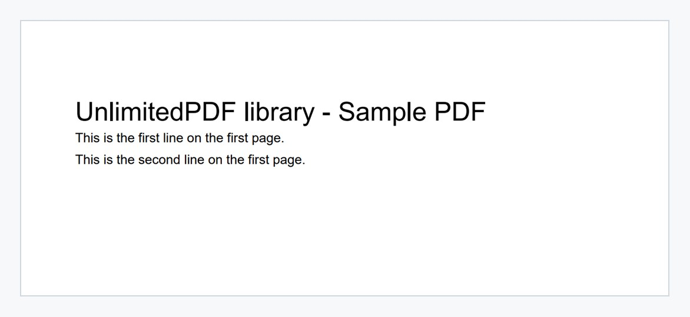
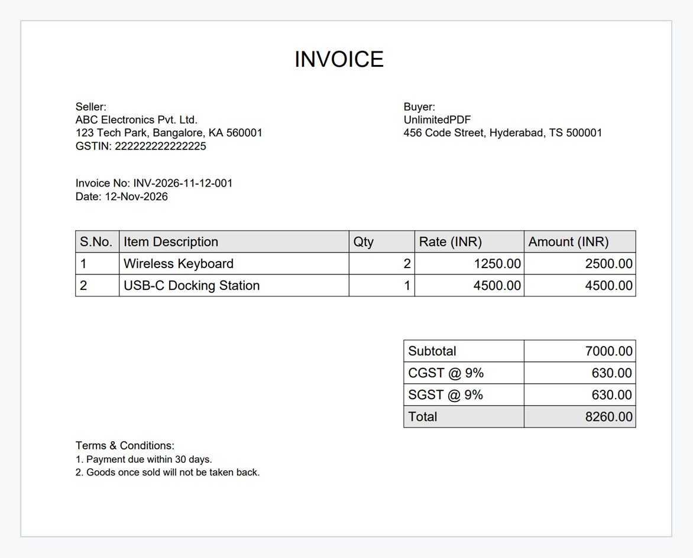
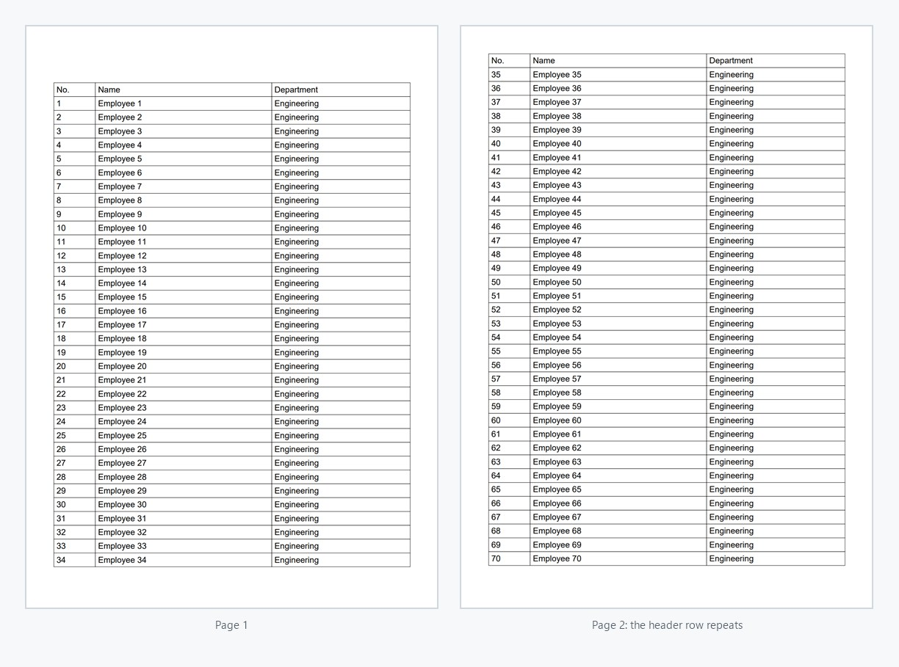
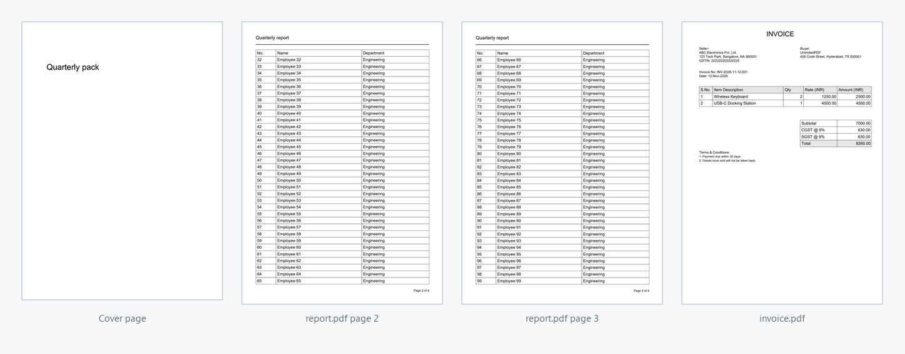
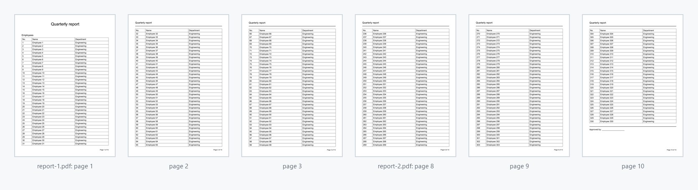
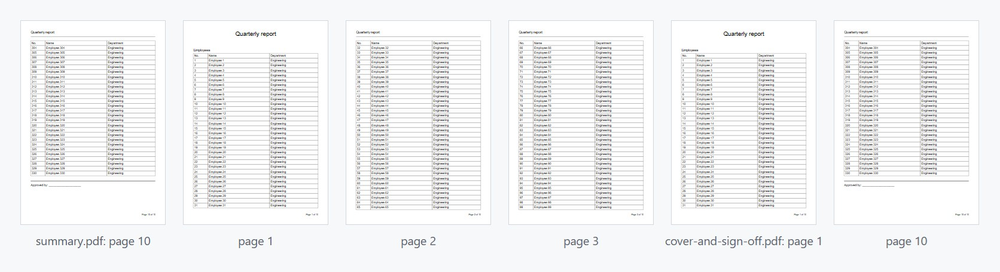
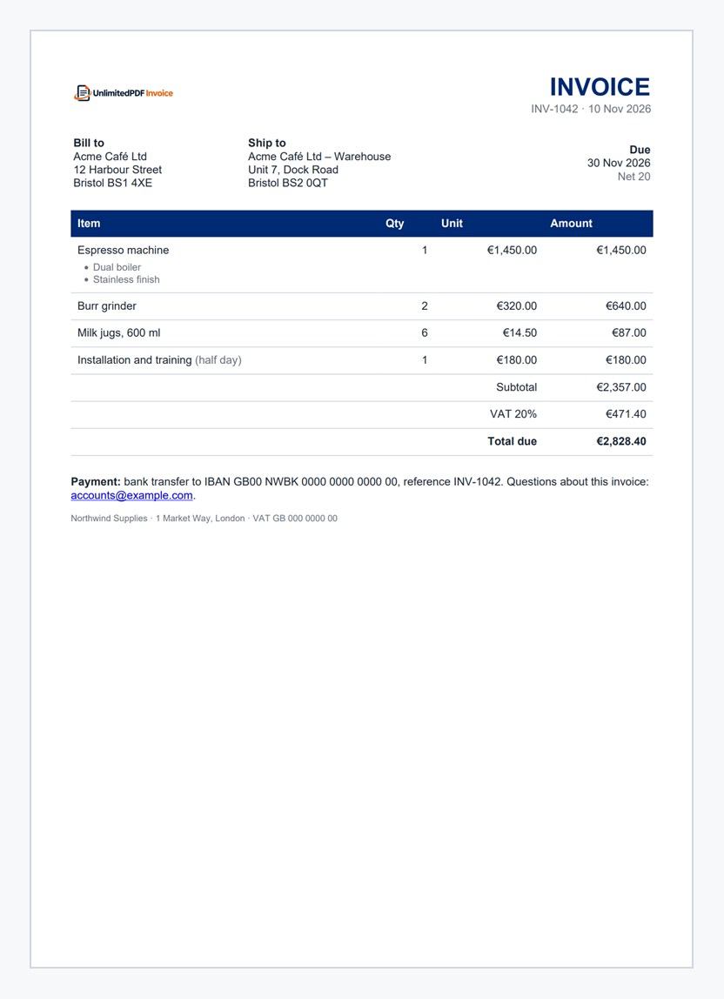

<p align="center">
  
</p>

<h3 align="center">UnlimitedPDF Library</h3>

<p align="center">
UnlimitedPDF is an enterprise-grade, pure .NET PDF library for creating PDF documents with text, tables, images, headers, and footers, merging, splitting, and extracting or removing pages of existing PDFs, and converting HTML to PDF, saved to a file or a stream.
</p>

<p align="center">
<b>Try it live:</b> <a href="https://unlimitedpdf.dev/">unlimitedpdf.dev</a>, where every demo builds its PDF in your browser and shows the C# code.
</p>

## Status

[](https://www.nuget.org/packages/UnlimitedPDF)
[](https://www.nuget.org/packages/UnlimitedPDF)

## Table of contents

- [Install](#install)
- [Demos](#demos)
- [Sample code](#sample-code)
- [Create a sample invoice](#create-a-sample-invoice)
- [Add images](#add-images)
- [Tables across pages](#tables-across-pages)
- [Headers, footers & flow](#headers-footers--flow)
- [Merge PDFs](#merge-pdfs)
- [Split PDFs](#split-pdfs)
- [Extract and remove pages](#extract-and-remove-pages)
- [HTML to PDF](#html-to-pdf)
- [Fonts and languages](#fonts-and-languages)
- [Upgrading to 1.0.0](#upgrading-to-100)
- [Changes in 1.1.0](#changes-in-110)
- [Changes in 1.0.1](#changes-in-101)
- [Changes in 1.0.0](#changes-in-100)

## Install

- **.NET CLI**
  
  Install with [NuGet](https://www.nuget.org/): `dotnet add package UnlimitedPDF --version 1.1.0`
  
- **Package Reference**
  
  Add package reference to project: `<PackageReference Include="UnlimitedPDF" Version="1.1.0" />`

- **Target frameworks**

  One package targets .NET 6, .NET 8, .NET 9, .NET 10, and .NET 11 (`net6.0`, `net8.0`, `net9.0`, `net10.0`, `net11.0`), including Blazor WebAssembly.

## Demos

`UnlimitedPDF.Demos.BlazorWasm` is an interactive site that runs entirely in the browser: no engine required, nothing uploaded. Its scenario gallery lists 25 scenarios by capability and business domain, and each scenario shows your data, the PDF drawn in the page, and the C# code side by side. Create: text and pages, tables, images, and headers and footers. Merge: join files, cover and ranges, pick pages, bookmarks and numbers, and document packs for finance, HR, and healthcare. Split and extract: every N pages, page ranges, extract pages, and remove pages. HTML to PDF: templates or your own HTML, and Common problems: HTML that often goes wrong in PDF, which you can open and edit. Languages (Fonts and languages, with text calls or HTML): an invoice in Hindi, Bengali, Gujarati, Punjabi, Odia, Kannada, Malayalam, Telugu, Tamil, French, Polish, Czech, Turkish, Filipino, Greek, Russian, Ukrainian, Armenian, Georgian, Arabic, Persian, Urdu, Hebrew, Dhivehi, or a mix, drawn with free fonts included for the demo or fonts you upload. Real-life documents: invoice (also quotation, purchase order, delivery note, and receipt), bulk invoices (up to 1,000, zipped), account statement (up to 5,000 rows), inventory report, payslip, contract, medical report, KPI report, and shipping labels. Each scenario has editable data, a download, and the C# code that builds it.

Try it live at [unlimitedpdf.dev](https://unlimitedpdf.dev/), or run it locally:

```bash
dotnet run --project UnlimitedPDF.Demos.BlazorWasm
```

## Sample Code

```cs
using UnlimitedPDF;

var pdfFilePath = "unlimited-pdf-sample.pdf";

var pdfDocument = new PdfDocument();

// Add the first page and add content to it.
var page1 = pdfDocument.AddPage();
page1.AddText("UnlimitedPDF library - Sample PDF", 50, 750, 24);
page1.AddText("This is the first line on the first page.", 50, 730, 12);
page1.AddText("This is the second line on the first page.", 50, 710, 12);

pdfDocument.Save(pdfFilePath);
```



## Create a sample invoice

```cs
using UnlimitedPDF;

Console.WriteLine("Start: Unlimited PDF");

var pdfFilePath = "unlimited-pdf-sample.pdf";

var pdfDocument = new PdfDocument();

// --- Page 1: Invoice ---
var page1 = pdfDocument.AddPage();

// 1. Invoice Header
page1.AddText("INVOICE", 250, 800, 20);

// Seller and Buyer Details
page1.AddText("Seller:", 50, 760, 10);
page1.AddText("ABC Electronics Pvt. Ltd.", 50, 748, 10);
page1.AddText("123 Tech Park, Bangalore, KA 560001", 50, 736, 10);
page1.AddText("GSTIN: 222222222222225", 50, 724, 10);

page1.AddText("Buyer:", 350, 760, 10);
page1.AddText("UnlimitedPDF", 350, 748, 10);
page1.AddText("456 Code Street, Hyderabad, TS 500001", 350, 736, 10);

// Invoice Metadata
page1.AddText($"Invoice No: INV-{DateTime.Now:yyyy-MM-dd}-001", 50, 690, 10);
page1.AddText($"Date: {DateTime.Now:dd-MMM-yyyy}", 50, 678, 10);

// 2. Items Table
var itemsTable = page1.AddTable(50, 650, 512);
itemsTable.SetColumnWidths(40, 210, 60, 100, 102);

// Table Headers
var headerRow = itemsTable.AddRow();
headerRow.GetCell(0).Text = "S.No.";
headerRow.GetCell(0).BackgroundColor = PdfColor.LightGray;
headerRow.GetCell(1).Text = "Item Description";
headerRow.GetCell(1).BackgroundColor = PdfColor.LightGray;
headerRow.GetCell(2).Text = "Qty";
headerRow.GetCell(2).BackgroundColor = PdfColor.LightGray;
headerRow.GetCell(3).Text = "Rate (INR)";
headerRow.GetCell(3).BackgroundColor = PdfColor.LightGray;
headerRow.GetCell(4).Text = "Amount (INR)";
headerRow.GetCell(4).BackgroundColor = PdfColor.LightGray;

// Item 1
var item1Row = itemsTable.AddRow();
item1Row.GetCell(0).Text = "1";
item1Row.GetCell(1).Text = "Wireless Keyboard";
item1Row.GetCell(2).Text = "2";
item1Row.GetCell(2).HorizontalAlignment = PdfCellHorizontalAlignment.Right;
item1Row.GetCell(3).Text = "1250.00";
item1Row.GetCell(3).HorizontalAlignment = PdfCellHorizontalAlignment.Right;
item1Row.GetCell(4).Text = "2500.00";
item1Row.GetCell(4).HorizontalAlignment = PdfCellHorizontalAlignment.Right;

// Item 2
var item2Row = itemsTable.AddRow();
item2Row.GetCell(0).Text = "2";
item2Row.GetCell(1).Text = "USB-C Docking Station";
item2Row.GetCell(2).Text = "1";
item2Row.GetCell(2).HorizontalAlignment = PdfCellHorizontalAlignment.Right;
item2Row.GetCell(3).Text = "4500.00";
item2Row.GetCell(3).HorizontalAlignment = PdfCellHorizontalAlignment.Right;
item2Row.GetCell(4).Text = "4500.00";
item2Row.GetCell(4).HorizontalAlignment = PdfCellHorizontalAlignment.Right;

// 3. Totals Section
double subtotal = 7000.00;
double cgst = subtotal * 0.09; // 9% CGST
double sgst = subtotal * 0.09; // 9% SGST
double total = subtotal + cgst + sgst;

var totalsTable = page1.AddTable(350, 550, 212);
totalsTable.SetColumnWidths(110, 102);

totalsTable.GetOrCreateCell(0, 0).Text = "Subtotal";
var subtotalValueCell = totalsTable.GetOrCreateCell(0, 1);
subtotalValueCell.Text = subtotal.ToString("F2");
subtotalValueCell.HorizontalAlignment = PdfCellHorizontalAlignment.Right;

totalsTable.GetOrCreateCell(1, 0).Text = "CGST @ 9%";
var cgstValueCell = totalsTable.GetOrCreateCell(1, 1);
cgstValueCell.Text = cgst.ToString("F2");
cgstValueCell.HorizontalAlignment = PdfCellHorizontalAlignment.Right;

totalsTable.GetOrCreateCell(2, 0).Text = "SGST @ 9%";
var sgstValueCell = totalsTable.GetOrCreateCell(2, 1);
sgstValueCell.Text = sgst.ToString("F2");
sgstValueCell.HorizontalAlignment = PdfCellHorizontalAlignment.Right;

var totalCell = totalsTable.GetOrCreateCell(3, 0);
totalCell.Text = "Total";
totalCell.BackgroundColor = PdfColor.LightGray;

var totalValueCell = totalsTable.GetOrCreateCell(3, 1);
totalValueCell.Text = total.ToString("F2");
totalValueCell.HorizontalAlignment = PdfCellHorizontalAlignment.Right;
totalValueCell.BackgroundColor = PdfColor.LightGray;

// 4. Terms and Conditions
page1.AddText("Terms & Conditions:", 50, 450, 10);
page1.AddText("1. Payment due within 30 days.", 50, 438, 9);
page1.AddText("2. Goods once sold will not be taken back.", 50, 426, 9);

pdfDocument.Save(pdfFilePath);

Console.WriteLine("End: Unlimited PDF");
```



## Add images

Load a JPEG or PNG once, then place it anywhere on any page, or inside table cells. Each image is stored once in the PDF, however many times it is placed, and one loaded image can be shared by many documents, including documents built in parallel.

```cs
using UnlimitedPDF;

// Load from a file, a Stream, or a byte array; async loading takes a cancellation token.
var logo = PdfImage.FromFile("logo.png");
var photo = await PdfImage.FromStreamAsync(uploadStream);

var pdfDocument = new PdfDocument();
var page = pdfDocument.AddPage();

// x and y are the image's bottom-left corner, in points from the page's bottom-left corner.
// With no size, images draw at 96 pixels per inch; with one size, the other keeps the aspect ratio.
page.AddImage(logo, 492, 762, width: 70);

// With both sizes the image stretches to fill the box, or fits inside it with Contain.
page.AddImage(photo, 50, 560, 150, 100, new PdfImagePlacementOptions { Fit = PdfImageFit.Contain });

// Lengths are always points; convert from millimeters, centimeters, inches, or pixels.
page.AddImage(photo, PdfUnits.FromMillimeters(20), PdfUnits.FromMillimeters(20), width: PdfUnits.FromInches(2));

// A cell holds an ordered list of text and images, drawn top to bottom.
// AtLeast rows grow to fit their content; Exactly rows (the default) keep their height and shrink images.
var table = page.AddTable(50, 500, 300);
table.SetColumnWidths(100, 200);
table.RowHeightMode = PdfRowHeightMode.AtLeast;
table.GetOrCreateCell(0, 0).SetContent(photo, "Laptop", "SKU 123");
table.GetOrCreateCell(0, 1).Text = "Image above two lines of text";

pdfDocument.Save("images.pdf");
```


- Supported formats: JPEG (baseline and progressive; grayscale, RGB, CMYK) and PNG (every color type and bit depth, interlaced or not, with transparency).
- Photos honor their EXIF orientation. Turn this off with `PdfImageLoadOptions.ApplyExifOrientation = false`.
- Bad input fails at load. Unsupported formats, damaged data, and images over the pixel limit throw `PdfImageException`. The limit is 100,000,000 pixels by default; change it with `PdfImageLoadOptions.MaxPixels` or `PdfImage.DefaultMaxPixels`.

## Tables across pages

A table that runs past the bottom of the page continues on a new page by itself. Rows are never split, and the new pages are added right after the table's page.

```cs
using UnlimitedPDF;

// Margins apply to every page; both default to 0 (the page edges).
var pdfDocument = new PdfDocument { MarginTop = 40, MarginBottom = 50 };
var page = pdfDocument.AddPage();

var table = page.AddTable(40, 760, 515);
table.SetColumnWidths(60, 255, 200);

// Mark the first row as a header and draw it again at the top of every new page.
table.HeaderRowCount = 1;
table.RepeatHeaderRows = true;
table.GetOrCreateCell(0, 0).Text = "No.";
table.GetOrCreateCell(0, 1).Text = "Name";
table.GetOrCreateCell(0, 2).Text = "Department";

for (int i = 1; i <= 200; i++)
{
    table.GetOrCreateCell(i, 0).Text = i.ToString();
    table.GetOrCreateCell(i, 1).Text = "Employee " + i;
    table.GetOrCreateCell(i, 2).Text = "Engineering";
}

pdfDocument.Save("directory.pdf");
```



- A row taller than the space between the margins, or header rows that cannot fit with one data row, make `Save` throw before anything is written.
- Tables that start on the same page share their continuation pages, so side-by-side tables stay side by side.
- Content you place at coordinates is never moved. To put content after a table, add both to the body flow (see [Headers, footers & flow](#headers-footers--flow)).

## Headers, footers & flow

Give every page a header and a footer, and let body content flow from page to page. Each body item stacks below the previous one, and the library adds pages as the content needs them.

```cs
using UnlimitedPDF;

var pdfDocument = new PdfDocument { MarginTop = 30, MarginBottom = 30, MarginLeft = 40, MarginRight = 40 };

// Drawn on every page. Offsets are measured from the band's top-left corner; content past the band is clipped.
pdfDocument.Header.Height = 40;
pdfDocument.Header.AddText("Quarterly report", 0, 8, 14);
pdfDocument.Header.AddRectangle(0, 36, 515, 1, PdfColor.Black);
pdfDocument.Footer.Height = 20;
pdfDocument.Footer.AddText("Page {page} of {pages}", 0, 4, 9, PdfTextAlignment.Right);

// The first page gets its own, taller header.
var first = pdfDocument.AddPageSettings(PdfPageTarget.First);
first.Header.Height = 70;
first.Header.AddText("Quarterly report", 0, 10, 24, PdfTextAlignment.Center);

// Body items stack below each other with a spacing and continue on new pages by themselves.
var body = pdfDocument.Body;
pdfDocument.BodyMarginTop = 12;
body.AddText("Employees", fontSize: 14, keepWithNext: true);

var table = body.AddTable(515, spacing: 6);
table.SetColumnWidths(60, 255, 200);
table.HeaderRowCount = 1;
table.RepeatHeaderRows = true;
table.GetOrCreateCell(0, 0).Text = "No.";
table.GetOrCreateCell(0, 1).Text = "Name";
table.GetOrCreateCell(0, 2).Text = "Department";

for (int i = 1; i <= 120; i++)
{
    table.GetOrCreateCell(i, 0).Text = i.ToString();
    table.GetOrCreateCell(i, 1).Text = "Employee " + i;
    table.GetOrCreateCell(i, 2).Text = "Engineering";
}

// A block moves to the next page as one piece, right after the table ends.
var signOff = body.AddBlock(spacing: 20);
signOff.AddRectangle(515, 1, PdfColor.Black);
signOff.AddText("Approved by: ____________________", spacing: 10);

pdfDocument.Save("report.pdf");
```


- `{page}` and `{pages}` show each page's number and the page count; `Header.SetPageContent(...)` and `Footer.SetPageContent(...)` set the content per page instead.
- Page settings for `First`, `Last`, `Odd`, `Even`, or a page number change a band's height, visibility, or content, the body margins, or the side margins. `Last` page settings may change content only.
- `keepWithNext` keeps an item, such as a heading, on the page of the item after it. Anything taller than an empty body makes `Save` throw before anything is written.
- `Body.RemainingHeight` is the room left where the next item lands. If what it measured changes afterwards, `Save` throws instead of writing a different layout.
- `Body.MaxPages` caps the page count; content that needs more pages makes `Save` throw, naming what does not fit.
- `AddPage` still works: it starts a new page in the flow, and its page-coordinate content is drawn where you place it.
- Text is aligned with the font's real character widths. It does not wrap.
- Documents that use none of these features are written exactly as before.

## Merge PDFs

Join existing PDFs into one file, or add their pages to a document you build. Each file is loaded and checked once with `PdfFile`, from a path, a stream, or bytes.

```cs
using UnlimitedPDF;

// Join whole files in one call. Each file gets a top-level bookmark.
var report = PdfFile.FromFile("report.pdf");
var invoice = PdfFile.FromFile("invoice.pdf");
PdfOperations.Merge("merged.pdf", report, invoice);

// Or build a cover page and choose page ranges.
var pdfDocument = new PdfDocument();
pdfDocument.Footer.Height = 20;
pdfDocument.Footer.AddText("Page {page} of {pages}", 0, 4, 9);
pdfDocument.AddPage().AddText("Quarterly pack", 72, 700, 24);
pdfDocument.AddPages(report, firstPage: 2, lastPage: 3, bookmarkTitle: "Quarterly report");
pdfDocument.AddPages(invoice);
pdfDocument.Save("pack.pdf");
```



- Imported pages keep their size, rotation, content, links, comments, layers, and bookmarks. Filled form fields keep their look but are no longer editable. Document metadata, attachments, and scripts are not copied.
- Imported pages take no new content and get no header, footer, or page settings, but they count in `{page}` and `{pages}` and act as a page break in the body flow.
- PDF 1.0 to 2.0 files load, including compressed cross-reference and object streams and incremental updates. A broken cross-reference table is repaired by scanning the file.
- Bad input fails at load with `PdfFileException`: encrypted files (`Encrypted`; they are not opened), damaged data (`Damaged`), files without pages (`Empty`), and files over a limit (`TooLarge`). The limits are 500 MB per file, 100 MB per decompressed stream, and 5,000,000 objects; change them with `PdfFileLoadOptions` or `PdfFile.DefaultMaxFileSize`, `PdfFile.DefaultMaxStreamSize`, and `PdfFile.DefaultMaxObjectCount`.
- Merging works in the browser too: load uploads with `PdfFile.FromStreamAsync`.

## Split PDFs

Split an existing PDF into smaller files: every few pages, or one file per page range. The file is loaded once with `PdfFile`, and each part is written as soon as it is built.

```cs
using System.IO.Compression;
using UnlimitedPDF;

var report = PdfFile.FromFile("report.pdf");

// One file per page, into a folder: pages/report-01.pdf, pages/report-02.pdf, ...
PdfOperations.Split(report, 1, "pages");

// One file per page range, in the order given. Ranges may overlap and leave pages out.
PdfOperations.Split(report, new[] { new PdfPageRange(1, 3), new PdfPageRange(8, 10) }, "chapters");

// Or write each part to a stream, for example a zip entry. Streams are left open, and a zip writes one entry at a
// time, so close each entry when the next part asks for its stream.
using (var zip = new ZipArchive(File.Create("report-parts.zip"), ZipArchiveMode.Create))
{
    Stream? entry = null;
    PdfOperations.Split(report, 4, part =>
    {
        entry?.Dispose();
        return entry = zip.CreateEntry(part.FileName).Open();
    });
    entry?.Dispose();
}
```



- Every N pages makes parts of N pages from the first page; the last part is shorter when the pages don't divide evenly. `PdfPageRange` pages are 1-based and inclusive. Every overload has a `SplitAsync` twin that takes a `CancellationToken`.
- Folder parts are named after the file and numbered, padded to the part count (`report-1.pdf` to `report-9.pdf`, or `report-01.pdf` to `report-12.pdf`); files loaded from a stream or bytes are named `part-1.pdf` and so on. The folder is created when missing, and existing files with those names are overwritten. Each call returns the parts (`PdfSplitPart`: `Number`, `FirstPage`, `LastPage`, `FileName`).
- Each part's pages keep their size, rotation, content, links, comments, and layers, and the part keeps the file's bookmarks that point into it, at their own levels. Links and bookmarks to pages in other parts are removed. Document metadata, attachments, and scripts are not copied.
- Parts are written one at a time. If a part can't be written, the parts before it are kept, its half-written file is removed, and `PdfSplitException` says which part failed (`PartNumber`) and how many were written (`PartsWritten`). An existing file with the failed part's name is removed too. A cancelled `SplitAsync` keeps the finished parts in the same way.
- Each page's fonts and images are copied as the file lists them. A file that lists all of its fonts and images for every page gives large parts.

## Extract and remove pages

Write the pages you choose to a new PDF, in your order, or write a PDF without them. Page lists such as `10, 1-3` are read with `PdfPageRange.Parse`, so text your users type can be passed straight in.

```cs
using UnlimitedPDF;

var report = PdfFile.FromFile("report.pdf");

// The pages you choose, in the order written: pages 10, 1, 2, and 3. A page can be chosen more than once.
PdfOperations.Extract(report, PdfPageRange.Parse("10, 1-3"), "summary.pdf");

// The PDF without the pages you choose; the pages left keep their order: pages 1 and 10.
PdfOperations.Remove(report, PdfPageRange.Parse("2-9"), "cover-and-sign-off.pdf");

// Or add the chosen pages to a document you build, under one bookmark.
var pack = new PdfDocument();
pack.AddPages(report, PdfPageRange.Parse("1, 10"), "Report");
pack.Save("pack.pdf");
```



- `Extract` writes the chosen pages in the order given; a page chosen more than once is copied each time, and links and bookmarks to it go to its first copy. `Remove` writes the pages not chosen, in their original order. Both take a path or a `Stream`, and `ExtractAsync` and `RemoveAsync` take a `CancellationToken`. The loaded file is not changed.
- `PdfPageRange.Parse` reads page numbers and ranges separated by commas, with spaces allowed; `9-7` gives pages 9, 8, and 7. Anything else, such as `7-` or `last`, throws `FormatException` naming the item, as does text that describes more than 1,000,000 pages. `Split` takes the same ranges.
- The new PDF keeps each page's look, the links between its pages, comments, and layers, the bookmarks that point at its pages at their own levels, and the file's title, author, subject, keywords, and XMP metadata. Filled form fields keep their look but are no longer editable; attachments, scripts, and page labels are not copied.
- Each page takes only the fonts, images, and other resources its content uses, so a few pages of a large file make a small file. A page whose content can't be read takes all of them, so the new PDF is always complete.
- A page past the last page, an empty list, and removing every page throw before anything is written, so an existing file stays as it was.
- `PdfDocument.AddPages(file, ranges, bookmarkTitle)` adds the chosen pages as one import with one bookmark, also with only the resources they use. A call that passes `null` as a page number by position, such as `AddPages(file, null, 7)`, no longer compiles; name the argument instead: `AddPages(file, lastPage: 7)`.

## HTML to PDF

Convert HTML into PDF with the library's own renderer: no browser, no extra package, and it runs wherever .NET runs, including Blazor WebAssembly. Load the HTML once with `PdfHtml`, then convert it in one call or add it to a document next to other content.

```cs
using UnlimitedPDF;

// One call: an HTML file with its images next to it, to A4 with half-inch margins.
var invoice = PdfHtml.FromFile("invoice.html");
PdfOperations.ConvertHtml(invoice, "invoice.pdf");
foreach (var warning in invoice.Warnings) Console.WriteLine(warning); // what was skipped, if anything

// Or mix HTML with other content: page numbers in the footer, headings as bookmarks.
var document = new PdfDocument { MarginTop = 36, MarginBottom = 36, MarginLeft = 36, MarginRight = 36 };
document.Footer.Height = 20;
document.Footer.AddText("Page {page} of {pages}", 0, 0);
document.Body.AddHtml(PdfHtml.FromString("<h1>Q3 Report</h1><p>Output rose <b>6%</b>.</p>"), headingBookmarks: true);
document.Save("report.pdf");

// Images from anywhere else come only through your resolver: the library never uses the network.
var options = new PdfHtmlLoadOptions
{
    ResourceResolver = reference => reference == "https://cdn.example.com/logo.png" ? File.OpenRead("logo.png") : null
};
var banner = PdfHtml.FromString("", options);
```



- Supported: block and inline layout with wrapping and justified text; headings, paragraphs, `div`, `span`, `blockquote`, `pre`, and the HTML5 section elements; nested `ul`, `ol`, and `dl` lists with every common marker style and `start`, `reversed`, and `value`; tables nested to any depth with `colspan`, `rowspan`, captions, and both border models; PNG and JPEG images; `<style>`, `<link rel="stylesheet">`, and `style` attributes with type, class, id, attribute, descendant, and child selectors; colors, fonts, sizes, margins, padding, borders, backgrounds, widths, and page breaks. HTML is laid out as a document, not as a browser shows it: scripts, flexbox, grid, floats, positioning, transforms, rounded corners, background images, and `@font-face` web fonts are not supported, and each one skipped is listed in `Warnings`.
- Fonts: text uses the standard PDF fonts unless you register your own: `serif` is Times, `monospace` is Courier, and other families are Helvetica, each with bold and italic, with Western European characters such as `é`, `ñ`, and `€`. Register fonts for other languages and characters; see [Fonts and languages](#fonts-and-languages).
- Pages: the HTML uses the document's page size and margins (A4 with 36 pt margins for `ConvertHtml`). Lines and images never split across pages, table rows move to the next page whole, `thead` rows repeat on every page, and a row taller than a page continues cell by cell. `break-before`, `break-after`, `break-inside: avoid`, and the `page-break-*` properties are honored. Content wider than the page narrows to fit; anything that still doesn't fit is clipped and reported.
- Resources: `data:` URIs, and relative paths inside the base folder (the HTML file's folder, or `BaseFolder`). Paths that leave that folder, absolute paths, and symbolic links are never read. Anything else goes to your `ResourceResolver` (or `ResourceResolverAsync` with the `Async` load methods). Images and stylesheets that can't be loaded are skipped, an image showing its `alt` text instead.
- Links: `http`, `https`, and `mailto` links are clickable, and `#id` links jump inside the document; other link types keep their text only. `headingBookmarks: true` turns `h1` to `h6` into bookmarks.
- Problems: anything skipped is listed in `PdfHtml.Warnings` (`Kind`, `Source`, `Line` or `PageNumber`). Set `FailOnWarning` to throw `PdfHtmlException` on the first one instead, for example in template tests. Limits keep hostile input in check: 50 MB of HTML, 256 levels of nesting, 50 MB per image or stylesheet, and 200 MB in total, changeable with the `PdfHtml.Default*` properties or per load.
- Known limitations: these come out differently from a browser. The playground's Common problems demo shows examples of the flexbox and grid, background image, SVG and WebP, character, and `pre` limitations, next to common HTML to PDF problems that this renderer handles, such as rows cut at page breaks, header rows that don't repeat, and long URLs.
  - Flexbox and grid: items are laid out as stacked blocks.
  - Floats and positioning: ignored; elements stay in the normal flow.
  - Background images: skipped; background colors are drawn.
  - Images other than PNG and JPEG, such as SVG and WebP: their `alt` text is shown.
  - Characters outside Western European that no registered or fallback font has, such as Cyrillic, Chinese, and emoji without a font for them: written as `?`, with a `MissingCharacter` warning.
  - `pre` lines don't wrap, as in a browser, so a line wider than the page is clipped; use `white-space: pre-wrap` to wrap it.

## Fonts and languages

Draw text in your own fonts: Hindi, Bengali, Assamese, Gujarati, Punjabi, Odia, Kannada, Malayalam, Telugu, Tamil, Arabic, Persian, Urdu, Pashto, Kurdish (Sorani), Sindhi, Uyghur, Malay (Jawi), Hebrew, Dhivehi, Greek, Russian, Ukrainian, Bulgarian, Serbian, Kazakh, Armenian, Georgian, French, Polish, Turkish, and other languages written in Latin letters, each shaped the way its script needs and written in its own direction. Load a `.ttf` or `.otf` font once with `PdfFont`, then pass it to any text call; characters it doesn't have come from the document's fallback fonts. The PDF embeds only the glyphs it uses, and copied or searched text reads back exactly as written.

Before you start, you need:

- A `.ttf` or `.otf` font that has the letters of each script you write: one font per script, or one that covers them all. The package includes no fonts; ship the font files with your app.
- The right to embed each font in a PDF. Check the font's license; free fonts under the SIL Open Font License, for example, allow it.
- A supported script: Latin, Greek, Cyrillic, Armenian, Georgian, Devanagari, Bengali-Assamese, Gujarati, Gurmukhi, Odia, Kannada, Malayalam, Telugu, Tamil, Arabic, Hebrew, or Thaana.
- A check for characters no font has: `FindMissingCharacters` or `FailOnMissingCharacters`, so none is drawn as `?`.

```cs
using UnlimitedPDF;

var latin = PdfFont.FromFile("fonts/BrandSans-Regular.ttf");
var hindi = PdfFont.FromFile("fonts/BrandDevanagari-Regular.ttf");
var telugu = PdfFont.FromFile("fonts/BrandTelugu-Regular.ttf");

var document = new PdfDocument();
document.FontFallback.Add(hindi); // used for characters the call's font doesn't have
document.FontFallback.Add(telugu);

var page = document.AddPage();
page.AddText("Invoice", latin, 72, 760, 18);
page.AddText("Merci, नमस्ते, ధన్యవాదాలు", latin, 72, 730); // three scripts in one line

// Find characters no font can draw before saving, or make Save fail on them instead of drawing '?'.
var missing = document.FindMissingCharacters("Thank you 🙏", latin); // ["🙏"]
document.FailOnMissingCharacters = true;
document.Save("invoice.pdf");

// HTML: register fonts under the family names your CSS uses.
var options = new PdfHtmlLoadOptions();
options.Fonts.Add("Brand Sans", latin);
options.Fonts.Add("Brand Sans", PdfFont.FromFile("fonts/BrandSans-Bold.ttf"));
options.Fonts.Add("Brand Devanagari", hindi);
var html = PdfHtml.FromString("<p style=\"font-family: 'Brand Sans', 'Brand Devanagari'\">Total <b>₹ 1,250</b> कुल</p>", options);
PdfOperations.ConvertHtml(html, "total.pdf");
```

Right-to-left documents set their direction once; text, alignment, and tables follow it:

```cs
using UnlimitedPDF;

var arabic = PdfFont.FromFile("fonts/BrandArabic-Regular.ttf");

var document = new PdfDocument { TextDirection = PdfTextDirection.RightToLeft };
document.FontFallback.Add(arabic);

document.Body.AddText("فاتورة رقم 42", arabic, fontSize: 18); // starts at the right edge
document.Body.AddText("iPhone 15 السعر", arabic); // still reads from the right
document.Body.AddText("Model X1", new PdfTextOptions { Direction = PdfTextDirection.LeftToRight }); // one left-to-right line

var table = document.Body.AddTable(400); // column 0 is drawn at the right
table.SetText(0, 0, "المنتج", arabic);
table.SetText(0, 1, "السعر", arabic);
document.Save("invoice-ar.pdf");
```

- Fonts: `PdfFont.FromFile`, `FromFileAsync`, `FromStream`, `FromStreamAsync`, and `FromBytes` load `.ttf` and `.otf` fonts with TrueType or CFF outlines. A variable font draws any weight it holds: `new PdfFontLoadOptions { Weight = 700 }`. Font collections (`.ttc`), WOFF, WOFF2, damaged fonts, fonts over 50 MB (`PdfFont.DefaultMaxFileSize`, or `MaxFileSize` per load), and fonts whose license forbids embedding throw `PdfFontException` with a `Reason`. Set `IgnoreEmbeddingRestrictions` only when you hold the rights to embed the font.
- Where: `PdfPage.AddText`, headers and footers, the body flow, flow blocks, table cells (`new PdfCellText(text, font)` or `PdfTable.SetText(row, column, text, font)`), and HTML. Each character takes the call's font, then the `PdfDocument.FontFallback` fonts in order, so one line can mix scripts.
- Scripts: Latin, Greek, Cyrillic, Armenian, and Georgian (accents, ligatures, kerning, each with its own script's font rules), Devanagari, Bengali-Assamese, Gujarati, Gurmukhi, Odia, Kannada, Malayalam, Telugu, and Tamil are shaped with the font's own rules: conjuncts, half forms, reph, vowel signs drawn before their consonant or split around it, and marks placed above and below. Arabic (with Persian, Urdu, Pashto, Sorani, Sindhi, Uyghur, and Jawi letters) takes its joined forms, required ligatures such as Lam with Alef, its marks, and the cursive attachment Nastaliq fonts use; Hebrew points and Thaana vowel signs sit on their letters. Copy, search, and read-aloud return the original text, in reading order.
- Direction: lines are ordered by the Unicode Bidirectional Algorithm, so Latin words, numbers (Western or Arabic-Indic, drawn as typed), and brackets inside Arabic or Hebrew text read correctly. `PdfDocument.TextDirection` sets the base direction; the default, `Auto`, takes each text's first letter, so documents without right-to-left text are unchanged. Override it for one call with `PdfTextOptions.Direction`, for a table with `PdfTable.Direction` (a right-to-left table draws its first column at the right), or for a cell's text with `PdfCellText.Direction`.
- Alignment: `PdfTextAlignment.Start` and `End`, and the same on `PdfCellHorizontalAlignment`, follow the text's direction, and `Start` is the default, so right-to-left text lands at the right edge without an argument. `Left`, `Center`, and `Right` stay where they say.
- Missing characters: a character no font has is drawn as `?`. `FindMissingCharacters` lists them before you save; `FailOnMissingCharacters` makes `Save` throw `PdfTextException` (the character, its text, and its page) before anything is written; HTML adds a `MissingCharacter` warning. Right-to-left letters of scripts that aren't shaped, such as Syriac or N'Ko, are reported the same way even when the font has them, because they would be drawn without their joining.
- Without a font: text uses the built-in Helvetica as before, and Western European characters such as `é`, `ñ`, `€`, dashes, and curly quotes are drawn as written. Other Latin letters, such as Polish `ł`, Czech `č`, Romanian `ș`, and Turkish `ğ` and `ı`, and every other script need a font of your own. Documents with only ASCII text are written byte for byte as before.
- HTML: `font-family` names map to the fonts registered in `PdfHtmlLoadOptions.Fonts`, matched by weight and style; register one font per weight and style, or one variable font, which draws CSS weights rounded to the nearest hundred (on the same side of 600, so bold stays bold). Each character takes the first listed family that has it, then the fallback fonts (`PdfDocument.FontFallback`, or `PdfHtmlConvertOptions.FontFallback` for `ConvertHtml`), then the standard fonts. When a bold or italic font is missing, the nearest registered one is used with a `MissingFontFace` warning; `SynthesizeMissingStyles` draws the regular font thickened or slanted instead. `@font-face` rules are ignored with a `FontFaceIgnored` warning, and their font files are never read. `text-transform` follows the `lang` attribute for Turkish and Azerbaijani, so `istanbul` in uppercase is `İSTANBUL`. The `dir` attribute (`ltr`, `rtl`, `auto`), CSS `direction`, `<bdi>`, and `<bdo>` set direction; `text-align: start` and `end`, table columns, and list markers follow it; HTML keeps its own direction rather than the document's.
- Known limitations:
  - Right-to-left scripts other than Arabic, Hebrew, and Thaana, such as Syriac, N'Ko, and Samaritan, are drawn without their script's shaping and reported as missing; Chinese, Japanese, and Korean are not supported.
  - HTML `unicode-bidi` is not supported, and Arabic is justified by widening spaces, not by stretching letters.
  - Letter forms a font keeps for one language, such as Bulgarian or Serbian Cyrillic, or Marathi Devanagari, aren't chosen; the font's default forms are drawn.
  - Font collections (`.ttc`) and web fonts (WOFF, WOFF2) can't be loaded; convert them to `.ttf` or `.otf`.
  - HTML `@font-face` rules are ignored; register fonts in code instead.

## Upgrading to 1.0.0

1.0.0 renames part of the API so that names follow one convention and are easier to guess. Old names are removed, so code written for 0.0.x reports compile errors until it uses the new names. Generated PDFs are unchanged. Every public type is now in the `UnlimitedPDF` namespace, so `using UnlimitedPDF;` is the only `using` you need.

| 0.0.x name | 1.0.0 name |
|---|---|
| `using UnlimitedPDF.Enums;` | delete it (types are in `UnlimitedPDF`) |
| `using UnlimitedPDF.Models.Table;` | delete it (types are in `UnlimitedPDF`) |
| `using UnlimitedPDF.Extensions;` | delete it (types are in `UnlimitedPDF`) |
| `PdfPageBuilder` | `PdfPage` |
| `PdfTableRow` | `PdfRow` |
| `PdfTableColumn` | `PdfColumn` |
| `PdfTableCell` | `PdfCell` |
| `PdfPageBuilder.AddText(string text, int x, int y, int fontSize, string fontName)` | `PdfPage.AddText(string text, double x, double y, double fontSize = 12)` (no font name; there is one font) |
| `PdfTable.ColCount` | `PdfTable.ColumnCount` |
| `PdfTable.TrimEmptyTrailingRowsAndCols()` | `PdfTable.TrimEmptyTrailingRowsAndColumns()` |
| `PdfTable.EnsureSize(rows, cols)` | `PdfTable.EnsureSize(rows, columns)` |
| `col` parameter of `PdfTable.GetCell`, `GetOrCreateCell`, `SetCell`, `SetText` | `column` (only named arguments change) |
| `new PdfTableRow(index, initialCols)` | `new PdfRow(index, initialColumns)` |
| `colIndex` parameter of `PdfTableRow.GetCell`, `SetCell` | `columnIndex` (only named arguments change) |
| `PdfTableCell.Background` | `PdfCell.BackgroundColor` |
| `PdfTableCell.ColSpan` | `PdfCell.ColumnSpan` |
| `PdfTableCell.HAlign` | `PdfCell.HorizontalAlignment` |
| `PdfTableCell.VAlign` | `PdfCell.VerticalAlignment` |
| `PdfTableCell.TopBorder`, `BottomBorder`, `LeftBorder`, `RightBorder` | `PdfCell.BorderTop`, `BorderBottom`, `BorderLeft`, `BorderRight` |
| `PdfTable.GetEffectiveColumnWidths()`, `NormalizeSpans()`, `IsSameSpanCell(...)` | removed (internal layout helpers) |
| `PdfPageSize.ToMediaBoxString()` | removed (internal PDF syntax); use `ToDimensions()` for the size in points |

## Changes in 1.1.0

- New: your own fonts and more languages (`PdfFont`, `PdfFontLoadOptions`, `PdfFontException`, `PdfFontErrorReason`): text in Hindi, Telugu, Tamil, and languages written in Latin letters, shaped by the font's rules, on every text call (`PdfPage.AddText`, headers, footers, the body flow, flow blocks, and table cells with `PdfCellText` and `PdfTable.SetText`). PDFs embed only the glyphs they use. See [Fonts and languages](#fonts-and-languages).
- New: fallback fonts and missing characters (`PdfDocument.FontFallback`, `PdfDocument.FindMissingCharacters`, `PdfDocument.FailOnMissingCharacters`, `PdfTextException`).
- New: fonts in HTML (`PdfHtmlLoadOptions.Fonts`, `PdfHtmlFontCollection`, `PdfHtmlLoadOptions.SynthesizeMissingStyles`, `PdfHtmlConvertOptions.FontFallback`), and the warning kinds `MissingCharacter`, `MissingFontFace`, and `FontFaceIgnored`.
- New: extract and remove pages (`PdfOperations.Extract`, `ExtractAsync`, `Remove`, `RemoveAsync`): write the pages you choose to a new PDF in your order, or write a PDF without them, keeping bookmarks, links between the kept pages, and the file's title and author, with only the fonts and images those pages use. See [Extract and remove pages](#extract-and-remove-pages).
- New: page lists as text (`PdfPageRange.Parse`), such as `2, 5, 7-9` or `9-7`, for `Extract`, `Remove`, and `Split`, and `PdfDocument.AddPages(file, ranges, bookmarkTitle)`, which adds the chosen pages to a document under one bookmark.
- Changed: text drawn without a font now shows Western European characters such as `é`, `ü`, `€`, dashes, and curly quotes instead of `?`. Documents with only ASCII text are written exactly as before.
- Changed: HTML reports each character it draws as `?` with a `MissingCharacter` warning, so `FailOnWarning` now fails on such characters, and reports `@font-face` as `FontFaceIgnored` instead of `UnsupportedProperty`.
- Changed: in HTML, a word wider than its line is split only between whole characters, so an emoji or a letter with its accent stays together.
- Changed: a call that passes `null` as a page number by position, such as `AddPages(file, null, 7)`, no longer compiles because of the new `AddPages` overload; name the argument instead: `AddPages(file, lastPage: 7)`. Built apps keep working.
- Fixed: table cell positions, sizes, and border widths are always written as plain decimal numbers. A very small or very large value used to be written in exponent form, such as `1E-05`, which PDF readers don't accept.
- Fixed: loading a damaged PDF to merge or split stays fast and small. Compressed data with out-of-range predictor settings is reported as a damaged file, and oversized named-destination names are skipped, instead of taking large amounts of memory and time.
- The package includes `THIRD-PARTY-NOTICES.txt`, the license of the Unicode data the script tables are built from.

## Changes in 1.0.1

- Fixed: text didn't show when a PDF was opened on an iPhone or iPad (Safari, Chrome, and other apps that use Apple's PDF viewer); only lines, fills, and images appeared. Every page now names the font its text uses. PDFs look the same in every other viewer, and the API is unchanged.

## Changes in 1.0.0

- New: merge PDFs (`PdfFile`, `PdfFileLoadOptions`, `PdfFileException`, `PdfDocument.AddPages`, `PdfOperations.Merge`): load existing PDFs, join whole files in one call, or add page ranges next to pages you build.
- New: split PDFs (`PdfOperations.Split`, `PdfOperations.SplitAsync`, `PdfPageRange`, `PdfSplitPart`, `PdfSplitException`): split a PDF every N pages or into one file per page range, written to a folder or to a stream per part.
- New: HTML to PDF (`PdfHtml`, `PdfHtmlLoadOptions`, `PdfHtmlWarning`, `PdfHtmlException`, `PdfBodyFlow.AddHtml`, `PdfOperations.ConvertHtml`, `PdfOperations.ConvertHtmlAsync`, `PdfHtmlConvertOptions`): convert HTML with CSS, nested tables and lists, images, and links into PDF with a built-in renderer, in one call or next to other content.
- New: tables continue on new pages when they pass the bottom of the page (`PdfDocument.MarginTop`, `PdfDocument.MarginBottom`, `PdfTable.HeaderRowCount`, `PdfTable.RepeatHeaderRows`). Tables that fit their page are drawn exactly as before.
- New: headers, footers, and body flow (`PdfDocument.Header`, `PdfDocument.Footer`, `PdfDocument.Body`, `PdfDocument.BodyMarginTop`, `PdfDocument.BodyMarginBottom`, `PdfDocument.AddPageSettings`, `PdfDocument.MarginLeft`, `PdfDocument.MarginRight`), and filled rectangles (`PdfPage.AddRectangle`).
- New: images (`PdfImage`, `PdfPage.AddImage`), images and stacked content in table cells, row height modes (`PdfRowHeightMode`), and unit conversion (`PdfUnits`).
- New: colors from 0–255 channels or hex strings (`PdfColor.FromRgb(0, 172, 140)`, `PdfColor.FromHex("#002A73")`).
- New: .NET 11 support (`net11.0`), alongside .NET 6, 8, 9, and 10.
- Renamed: see [Upgrading to 1.0.0](#upgrading-to-100).
- `PdfCell.Text` now reads and writes the cell's first text item; text-only cells behave as before.
- Table cells with `VerticalAlignment` set to `Top` or `Bottom` are now drawn that way (it had no effect before).
- Text containing a backslash or an unbalanced parenthesis is now escaped wherever it appears (table cells, `PdfPage.AddText`, headers, footers, and the body flow), so it displays as written. Text without those characters is written exactly as before.
- Table numbers are written the same way in every culture, so documents saved under comma-decimal cultures are valid.
