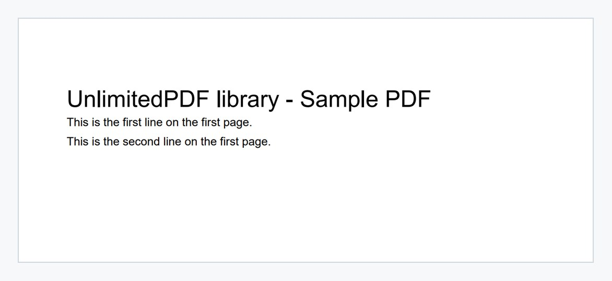
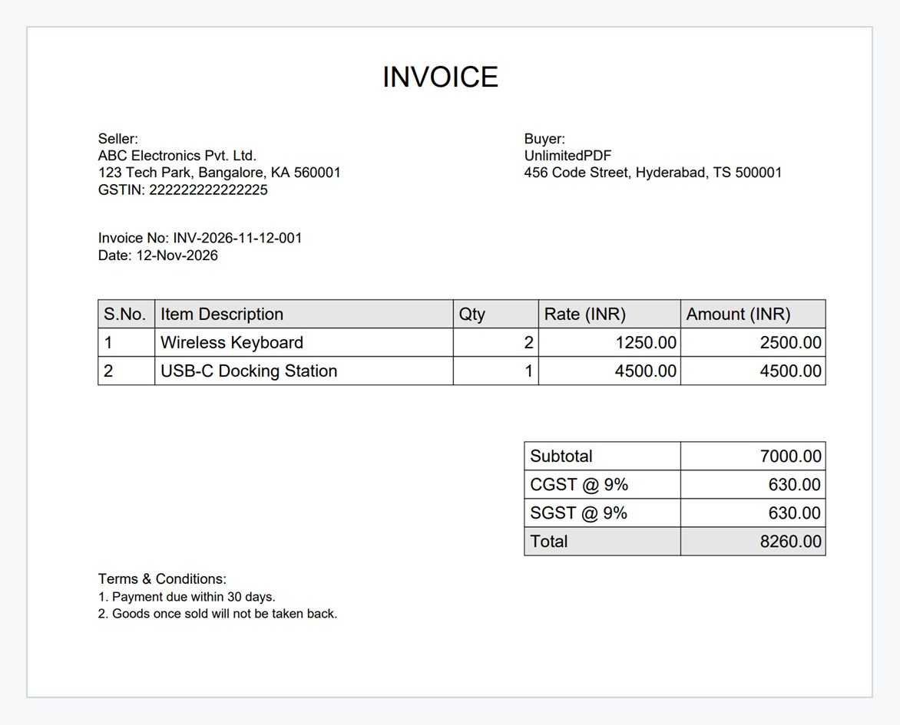

# Create PDFs: text, pages, and tables

[README](../../README.md) · [All guides](README.md) · [Try it live](https://unlimitedpdf.dev/playground/create/text-and-pages)

## Sample code

```cs
using UnlimitedPDF;

var pdfFilePath = "unlimited-pdf-sample.pdf";

var pdfDocument = new PdfDocument();

// Add the first page and add content to it.
var page1 = pdfDocument.AddPage();
page1.AddText("UnlimitedPDF library - Sample PDF", 50, 750, 24);
page1.AddText("This is the first line on the first page.", 50, 730, 12);
page1.AddText("This is the second line on the first page.", 50, 710, 12);

pdfDocument.Save(pdfFilePath);
```



## Create a sample invoice

```cs
using UnlimitedPDF;

Console.WriteLine("Start: Unlimited PDF");

var pdfFilePath = "unlimited-pdf-sample.pdf";

var pdfDocument = new PdfDocument();

// --- Page 1: Invoice ---
var page1 = pdfDocument.AddPage();

// 1. Invoice Header
page1.AddText("INVOICE", 250, 800, 20);

// Seller and Buyer Details
page1.AddText("Seller:", 50, 760, 10);
page1.AddText("ABC Electronics Pvt. Ltd.", 50, 748, 10);
page1.AddText("123 Tech Park, Bangalore, KA 560001", 50, 736, 10);
page1.AddText("GSTIN: 222222222222225", 50, 724, 10);

page1.AddText("Buyer:", 350, 760, 10);
page1.AddText("UnlimitedPDF", 350, 748, 10);
page1.AddText("456 Code Street, Hyderabad, TS 500001", 350, 736, 10);

// Invoice Metadata
page1.AddText($"Invoice No: INV-{DateTime.Now:yyyy-MM-dd}-001", 50, 690, 10);
page1.AddText($"Date: {DateTime.Now:dd-MMM-yyyy}", 50, 678, 10);

// 2. Items Table
var itemsTable = page1.AddTable(50, 650, 512);
itemsTable.SetColumnWidths(40, 210, 60, 100, 102);

// Table Headers
var headerRow = itemsTable.AddRow();
headerRow.GetCell(0).Text = "S.No.";
headerRow.GetCell(0).BackgroundColor = PdfColor.LightGray;
headerRow.GetCell(1).Text = "Item Description";
headerRow.GetCell(1).BackgroundColor = PdfColor.LightGray;
headerRow.GetCell(2).Text = "Qty";
headerRow.GetCell(2).BackgroundColor = PdfColor.LightGray;
headerRow.GetCell(3).Text = "Rate (INR)";
headerRow.GetCell(3).BackgroundColor = PdfColor.LightGray;
headerRow.GetCell(4).Text = "Amount (INR)";
headerRow.GetCell(4).BackgroundColor = PdfColor.LightGray;

// Item 1
var item1Row = itemsTable.AddRow();
item1Row.GetCell(0).Text = "1";
item1Row.GetCell(1).Text = "Wireless Keyboard";
item1Row.GetCell(2).Text = "2";
item1Row.GetCell(2).HorizontalAlignment = PdfCellHorizontalAlignment.Right;
item1Row.GetCell(3).Text = "1250.00";
item1Row.GetCell(3).HorizontalAlignment = PdfCellHorizontalAlignment.Right;
item1Row.GetCell(4).Text = "2500.00";
item1Row.GetCell(4).HorizontalAlignment = PdfCellHorizontalAlignment.Right;

// Item 2
var item2Row = itemsTable.AddRow();
item2Row.GetCell(0).Text = "2";
item2Row.GetCell(1).Text = "USB-C Docking Station";
item2Row.GetCell(2).Text = "1";
item2Row.GetCell(2).HorizontalAlignment = PdfCellHorizontalAlignment.Right;
item2Row.GetCell(3).Text = "4500.00";
item2Row.GetCell(3).HorizontalAlignment = PdfCellHorizontalAlignment.Right;
item2Row.GetCell(4).Text = "4500.00";
item2Row.GetCell(4).HorizontalAlignment = PdfCellHorizontalAlignment.Right;

// 3. Totals Section
double subtotal = 7000.00;
double cgst = subtotal * 0.09; // 9% CGST
double sgst = subtotal * 0.09; // 9% SGST
double total = subtotal + cgst + sgst;

var totalsTable = page1.AddTable(350, 550, 212);
totalsTable.SetColumnWidths(110, 102);

totalsTable.GetOrCreateCell(0, 0).Text = "Subtotal";
var subtotalValueCell = totalsTable.GetOrCreateCell(0, 1);
subtotalValueCell.Text = subtotal.ToString("F2");
subtotalValueCell.HorizontalAlignment = PdfCellHorizontalAlignment.Right;

totalsTable.GetOrCreateCell(1, 0).Text = "CGST @ 9%";
var cgstValueCell = totalsTable.GetOrCreateCell(1, 1);
cgstValueCell.Text = cgst.ToString("F2");
cgstValueCell.HorizontalAlignment = PdfCellHorizontalAlignment.Right;

totalsTable.GetOrCreateCell(2, 0).Text = "SGST @ 9%";
var sgstValueCell = totalsTable.GetOrCreateCell(2, 1);
sgstValueCell.Text = sgst.ToString("F2");
sgstValueCell.HorizontalAlignment = PdfCellHorizontalAlignment.Right;

var totalCell = totalsTable.GetOrCreateCell(3, 0);
totalCell.Text = "Total";
totalCell.BackgroundColor = PdfColor.LightGray;

var totalValueCell = totalsTable.GetOrCreateCell(3, 1);
totalValueCell.Text = total.ToString("F2");
totalValueCell.HorizontalAlignment = PdfCellHorizontalAlignment.Right;
totalValueCell.BackgroundColor = PdfColor.LightGray;

// 4. Terms and Conditions
page1.AddText("Terms & Conditions:", 50, 450, 10);
page1.AddText("1. Payment due within 30 days.", 50, 438, 9);
page1.AddText("2. Goods once sold will not be taken back.", 50, 426, 9);

pdfDocument.Save(pdfFilePath);

Console.WriteLine("End: Unlimited PDF");
```


