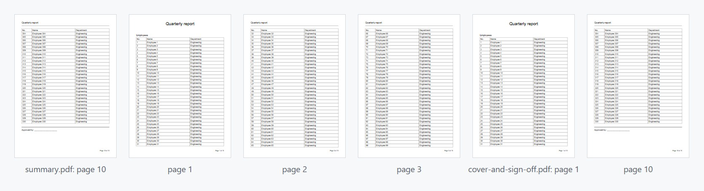

# Extract and remove pages

[README](../../README.md) · [All guides](README.md) · [Try it live](https://unlimitedpdf.dev/playground/split/extract-pages)

Write the pages you choose to a new PDF, in your order, or write a PDF without them. Page lists such as `10, 1-3` are read with `PdfPageRange.Parse`, so text your users type can be passed straight in.

```cs
using UnlimitedPDF;

var report = PdfFile.FromFile("report.pdf");

// The pages you choose, in the order written: pages 10, 1, 2, and 3. A page can be chosen more than once.
PdfOperations.Extract(report, PdfPageRange.Parse("10, 1-3"), "summary.pdf");

// The PDF without the pages you choose; the pages left keep their order: pages 1 and 10.
PdfOperations.Remove(report, PdfPageRange.Parse("2-9"), "cover-and-sign-off.pdf");

// Or add the chosen pages to a document you build, under one bookmark.
var pack = new PdfDocument();
pack.AddPages(report, PdfPageRange.Parse("1, 10"), "Report");
pack.Save("pack.pdf");
```



- `Extract` writes the chosen pages in the order given; a page chosen more than once is copied each time, and links and bookmarks to it go to its first copy. `Remove` writes the pages not chosen, in their original order. Both take a path or a `Stream`, and `ExtractAsync` and `RemoveAsync` take a `CancellationToken`. The loaded file is not changed.
- `PdfPageRange.Parse` reads page numbers and ranges separated by commas, with spaces allowed; `9-7` gives pages 9, 8, and 7. Anything else, such as `7-` or `last`, throws `FormatException` naming the item, as does text that describes more than 1,000,000 pages. `Split` takes the same ranges.
- The new PDF keeps each page's look, the links between its pages, comments, and layers, the bookmarks that point at its pages at their own levels, and the file's title, author, subject, keywords, and XMP metadata. Filled form fields keep their look but are no longer editable; attachments, scripts, and page labels are not copied.
- Each page takes only the fonts, images, and other resources its content uses, so a few pages of a large file make a small file. A page whose content can't be read takes all of them, so the new PDF is always complete.
- A page past the last page, an empty list, and removing every page throw before anything is written, so an existing file stays as it was.
- `PdfDocument.AddPages(file, ranges, bookmarkTitle)` adds the chosen pages as one import with one bookmark, also with only the resources they use. A call that passes `null` as a page number by position, such as `AddPages(file, null, 7)`, no longer compiles; name the argument instead: `AddPages(file, lastPage: 7)`.
