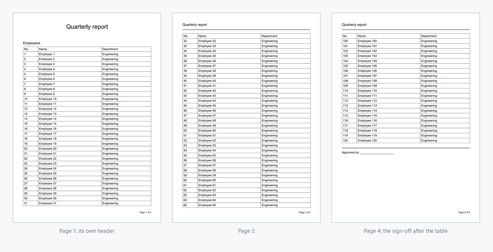

# Headers, footers & flow

[README](../../README.md) · [All guides](README.md) · [Try it live](https://unlimitedpdf.dev/playground/create/headers-and-footers)

Give every page a header and a footer, and let body content flow from page to page. Each body item stacks below the previous one, and the library adds pages as the content needs them.

```cs
using UnlimitedPDF;

var pdfDocument = new PdfDocument { MarginTop = 30, MarginBottom = 30, MarginLeft = 40, MarginRight = 40 };

// Drawn on every page. Offsets are measured from the band's top-left corner; content past the band is clipped.
pdfDocument.Header.Height = 40;
pdfDocument.Header.AddText("Quarterly report", 0, 8, 14);
pdfDocument.Header.AddRectangle(0, 36, 515, 1, PdfColor.Black);
pdfDocument.Footer.Height = 20;
pdfDocument.Footer.AddText("Page {page} of {pages}", 0, 4, 9, PdfTextAlignment.Right);

// The first page gets its own, taller header.
var first = pdfDocument.AddPageSettings(PdfPageTarget.First);
first.Header.Height = 70;
first.Header.AddText("Quarterly report", 0, 10, 24, PdfTextAlignment.Center);

// Body items stack below each other with a spacing and continue on new pages by themselves.
var body = pdfDocument.Body;
pdfDocument.BodyMarginTop = 12;
body.AddText("Employees", fontSize: 14, keepWithNext: true);

var table = body.AddTable(515, spacing: 6);
table.SetColumnWidths(60, 255, 200);
table.HeaderRowCount = 1;
table.RepeatHeaderRows = true;
table.GetOrCreateCell(0, 0).Text = "No.";
table.GetOrCreateCell(0, 1).Text = "Name";
table.GetOrCreateCell(0, 2).Text = "Department";

for (int i = 1; i <= 120; i++)
{
    table.GetOrCreateCell(i, 0).Text = i.ToString();
    table.GetOrCreateCell(i, 1).Text = "Employee " + i;
    table.GetOrCreateCell(i, 2).Text = "Engineering";
}

// A block moves to the next page as one piece, right after the table ends.
var signOff = body.AddBlock(spacing: 20);
signOff.AddRectangle(515, 1, PdfColor.Black);
signOff.AddText("Approved by: ____________________", spacing: 10);

pdfDocument.Save("report.pdf");
```



- `{page}` and `{pages}` show each page's number and the page count; `Header.SetPageContent(...)` and `Footer.SetPageContent(...)` set the content per page instead.
- Page settings for `First`, `Last`, `Odd`, `Even`, or a page number change a band's height, visibility, or content, the body margins, or the side margins. `Last` page settings may change content only.
- `keepWithNext` keeps an item, such as a heading, on the page of the item after it. Anything taller than an empty body makes `Save` throw before anything is written.
- `Body.RemainingHeight` is the room left where the next item lands. If what it measured changes afterwards, `Save` throws instead of writing a different layout.
- `Body.MaxPages` caps the page count; content that needs more pages makes `Save` throw, naming what does not fit.
- `AddPage` still works: it starts a new page in the flow, and its page-coordinate content is drawn where you place it.
- Text is aligned with the font's real character widths. It does not wrap.
- Documents that use none of these features are written exactly as before.
