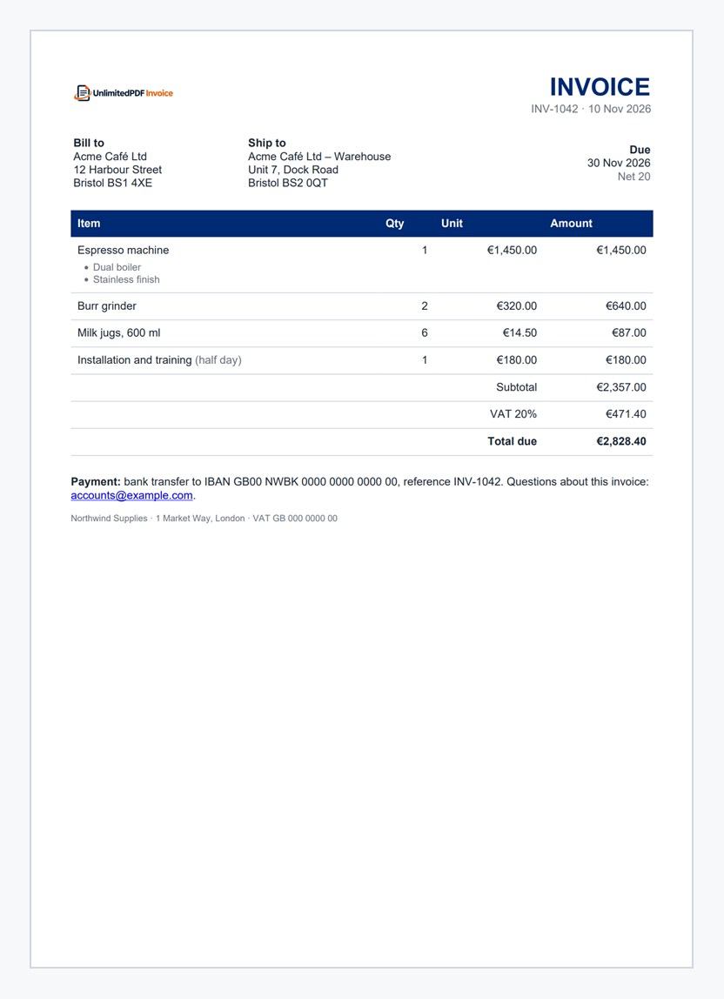

# HTML to PDF

[README](../../README.md) · [All guides](README.md) · [Try it live](https://unlimitedpdf.dev/playground/html/html-to-pdf)

Convert HTML into PDF with the library's own renderer: no browser, no extra package, and it runs wherever .NET runs, including Blazor WebAssembly. Load the HTML once with `PdfHtml`, then convert it in one call or add it to a document next to other content.

```cs
using UnlimitedPDF;

// One call: an HTML file with its images next to it, to A4 with half-inch margins.
var invoice = PdfHtml.FromFile("invoice.html");
PdfOperations.ConvertHtml(invoice, "invoice.pdf");
foreach (var warning in invoice.Warnings) Console.WriteLine(warning); // what was skipped, if anything

// Or mix HTML with other content: page numbers in the footer, headings as bookmarks.
var document = new PdfDocument { MarginTop = 36, MarginBottom = 36, MarginLeft = 36, MarginRight = 36 };
document.Footer.Height = 20;
document.Footer.AddText("Page {page} of {pages}", 0, 0);
document.Body.AddHtml(PdfHtml.FromString("<h1>Q3 Report</h1><p>Output rose <b>6%</b>.</p>"), headingBookmarks: true);
document.Save("report.pdf");

// Images from anywhere else come only through your resolver: the library never uses the network.
var options = new PdfHtmlLoadOptions
{
    ResourceResolver = reference => reference == "https://cdn.example.com/logo.png" ? File.OpenRead("logo.png") : null
};
var banner = PdfHtml.FromString("", options);
```



- Supported: block and inline layout with wrapping and justified text; headings, paragraphs, `div`, `span`, `blockquote`, `pre`, and the HTML5 section elements; nested `ul`, `ol`, and `dl` lists with every common marker style and `start`, `reversed`, and `value`; tables nested to any depth with `colspan`, `rowspan`, captions, and both border models; PNG and JPEG images; `<style>`, `<link rel="stylesheet">`, and `style` attributes with type, class, id, attribute, descendant, and child selectors; colors, fonts, sizes, margins, padding, borders, backgrounds, widths, and page breaks. HTML is laid out as a document, not as a browser shows it: scripts, flexbox, grid, floats, positioning, transforms, rounded corners, background images, and `@font-face` web fonts are not supported, and each one skipped is listed in `Warnings`.
- Fonts: text uses the standard PDF fonts unless you register your own: `serif` is Times, `monospace` is Courier, and other families are Helvetica, each with bold and italic, with Western European characters such as `é`, `ñ`, and `€`. Register fonts for other languages and characters; see [Fonts and languages](fonts-and-languages.md).
- Pages: the HTML uses the document's page size and margins (A4 with 36 pt margins for `ConvertHtml`). Lines and images never split across pages, table rows move to the next page whole, `thead` rows repeat on every page, and a row taller than a page continues cell by cell. `break-before`, `break-after`, `break-inside: avoid`, and the `page-break-*` properties are honored. Content wider than the page narrows to fit; anything that still doesn't fit is clipped and reported.
- Resources: `data:` URIs, and relative paths inside the base folder (the HTML file's folder, or `BaseFolder`). Paths that leave that folder, absolute paths, and symbolic links are never read. Anything else goes to your `ResourceResolver` (or `ResourceResolverAsync` with the `Async` load methods). Images and stylesheets that can't be loaded are skipped, an image showing its `alt` text instead.
- Links: `http`, `https`, and `mailto` links are clickable, and `#id` links jump inside the document; other link types keep their text only. `headingBookmarks: true` turns `h1` to `h6` into bookmarks.
- Problems: anything skipped is listed in `PdfHtml.Warnings` (`Kind`, `Source`, `Line` or `PageNumber`). Set `FailOnWarning` to throw `PdfHtmlException` on the first one instead, for example in template tests. Limits keep hostile input in check: 50 MB of HTML, 256 levels of nesting, 50 MB per image or stylesheet, and 200 MB in total, changeable with the `PdfHtml.Default*` properties or per load.
- Known limitations: these come out differently from a browser. The playground's Common problems demo shows examples of the flexbox and grid, background image, SVG and WebP, character, and `pre` limitations, next to common HTML to PDF problems that this renderer handles, such as rows cut at page breaks, header rows that don't repeat, and long URLs.
  - Flexbox and grid: items are laid out as stacked blocks.
  - Floats and positioning: ignored; elements stay in the normal flow.
  - Background images: skipped; background colors are drawn.
  - Images other than PNG and JPEG, such as SVG and WebP: their `alt` text is shown.
  - Characters outside Western European that no registered or fallback font has, such as Cyrillic, Chinese, and emoji without a font for them: written as `?`, with a `MissingCharacter` warning.
  - `pre` lines don't wrap, as in a browser, so a line wider than the page is clipped; use `white-space: pre-wrap` to wrap it.
