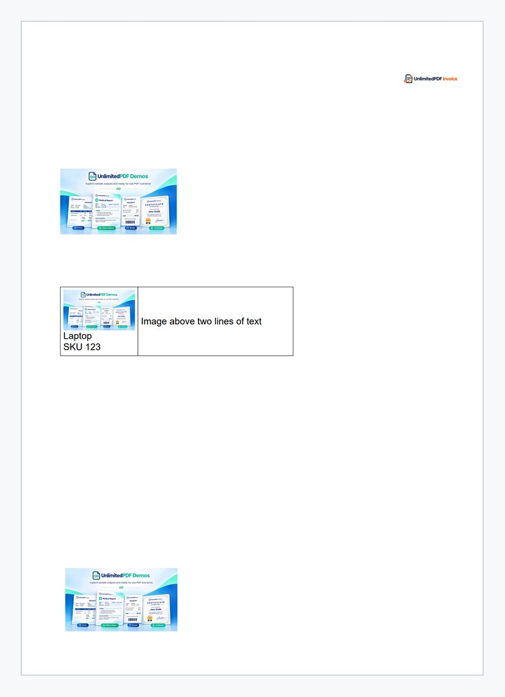

# Add images

[README](../../README.md) · [All guides](README.md) · [Try it live](https://unlimitedpdf.dev/playground/create/images)

Load a JPEG or PNG once, then place it anywhere on any page, or inside table cells. Each image is stored once in the PDF, however many times it is placed, and one loaded image can be shared by many documents, including documents built in parallel.

```cs
using UnlimitedPDF;

// Load from a file, a Stream, or a byte array; async loading takes a cancellation token.
var logo = PdfImage.FromFile("logo.png");
var photo = await PdfImage.FromStreamAsync(uploadStream);

var pdfDocument = new PdfDocument();
var page = pdfDocument.AddPage();

// x and y are the image's bottom-left corner, in points from the page's bottom-left corner.
// With no size, images draw at 96 pixels per inch; with one size, the other keeps the aspect ratio.
page.AddImage(logo, 492, 762, width: 70);

// With both sizes the image stretches to fill the box, or fits inside it with Contain.
page.AddImage(photo, 50, 560, 150, 100, new PdfImagePlacementOptions { Fit = PdfImageFit.Contain });

// Lengths are always points; convert from millimeters, centimeters, inches, or pixels.
page.AddImage(photo, PdfUnits.FromMillimeters(20), PdfUnits.FromMillimeters(20), width: PdfUnits.FromInches(2));

// A cell holds an ordered list of text and images, drawn top to bottom.
// AtLeast rows grow to fit their content; Exactly rows (the default) keep their height and shrink images.
var table = page.AddTable(50, 500, 300);
table.SetColumnWidths(100, 200);
table.RowHeightMode = PdfRowHeightMode.AtLeast;
table.GetOrCreateCell(0, 0).SetContent(photo, "Laptop", "SKU 123");
table.GetOrCreateCell(0, 1).Text = "Image above two lines of text";

pdfDocument.Save("images.pdf");
```



- Supported formats: JPEG (baseline and progressive; grayscale, RGB, CMYK) and PNG (every color type and bit depth, interlaced or not, with transparency).
- Photos honor their EXIF orientation. Turn this off with `PdfImageLoadOptions.ApplyExifOrientation = false`.
- Bad input fails at load. Unsupported formats, damaged data, and images over the pixel limit throw `PdfImageException`. The limit is 100,000,000 pixels by default; change it with `PdfImageLoadOptions.MaxPixels` or `PdfImage.DefaultMaxPixels`.
