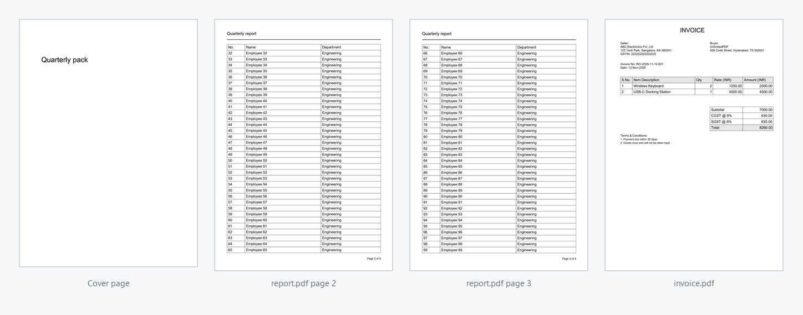

# Merge PDFs

[README](../../README.md) · [All guides](README.md) · [Try it live](https://unlimitedpdf.dev/playground/merge/join-files)

Join existing PDFs into one file, or add their pages to a document you build. Each file is loaded and checked once with `PdfFile`, from a path, a stream, or bytes.

```cs
using UnlimitedPDF;

// Join whole files in one call. Each file gets a top-level bookmark.
var report = PdfFile.FromFile("report.pdf");
var invoice = PdfFile.FromFile("invoice.pdf");
PdfOperations.Merge("merged.pdf", report, invoice);

// Or build a cover page and choose page ranges.
var pdfDocument = new PdfDocument();
pdfDocument.Footer.Height = 20;
pdfDocument.Footer.AddText("Page {page} of {pages}", 0, 4, 9);
pdfDocument.AddPage().AddText("Quarterly pack", 72, 700, 24);
pdfDocument.AddPages(report, firstPage: 2, lastPage: 3, bookmarkTitle: "Quarterly report");
pdfDocument.AddPages(invoice);
pdfDocument.Save("pack.pdf");
```



- Imported pages keep their size, rotation, content, links, comments, layers, and bookmarks. Filled form fields keep their look but are no longer editable. Document metadata, attachments, and scripts are not copied.
- Imported pages take no new content and get no header, footer, or page settings, but they count in `{page}` and `{pages}` and act as a page break in the body flow.
- PDF 1.0 to 2.0 files load, including compressed cross-reference and object streams and incremental updates. A broken cross-reference table is repaired by scanning the file.
- Bad input fails at load with `PdfFileException`: encrypted files (`Encrypted`; they are not opened), damaged data (`Damaged`), files without pages (`Empty`), and files over a limit (`TooLarge`). The limits are 500 MB per file, 100 MB per decompressed stream, and 5,000,000 objects; change them with `PdfFileLoadOptions` or `PdfFile.DefaultMaxFileSize`, `PdfFile.DefaultMaxStreamSize`, and `PdfFile.DefaultMaxObjectCount`.
- Merging works in the browser too: load uploads with `PdfFile.FromStreamAsync`.
