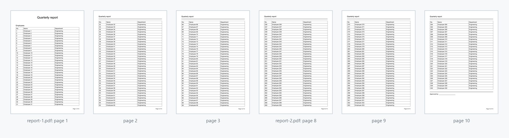

# Split PDFs

[README](../../README.md) · [All guides](README.md) · [Try it live](https://unlimitedpdf.dev/playground/split/every-n-pages)

Split an existing PDF into smaller files: every few pages, or one file per page range. The file is loaded once with `PdfFile`, and each part is written as soon as it is built.

```cs
using System.IO.Compression;
using UnlimitedPDF;

var report = PdfFile.FromFile("report.pdf");

// One file per page, into a folder: pages/report-01.pdf, pages/report-02.pdf, ...
PdfOperations.Split(report, 1, "pages");

// One file per page range, in the order given. Ranges may overlap and leave pages out.
PdfOperations.Split(report, new[] { new PdfPageRange(1, 3), new PdfPageRange(8, 10) }, "chapters");

// Or write each part to a stream, for example a zip entry. Streams are left open, and a zip writes one entry at a
// time, so close each entry when the next part asks for its stream.
using (var zip = new ZipArchive(File.Create("report-parts.zip"), ZipArchiveMode.Create))
{
    Stream? entry = null;
    PdfOperations.Split(report, 4, part =>
    {
        entry?.Dispose();
        return entry = zip.CreateEntry(part.FileName).Open();
    });
    entry?.Dispose();
}
```



- Every N pages makes parts of N pages from the first page; the last part is shorter when the pages don't divide evenly. `PdfPageRange` pages are 1-based and inclusive. Every overload has a `SplitAsync` twin that takes a `CancellationToken`.
- Folder parts are named after the file and numbered, padded to the part count (`report-1.pdf` to `report-9.pdf`, or `report-01.pdf` to `report-12.pdf`); files loaded from a stream or bytes are named `part-1.pdf` and so on. The folder is created when missing, and existing files with those names are overwritten. Each call returns the parts (`PdfSplitPart`: `Number`, `FirstPage`, `LastPage`, `FileName`).
- Each part's pages keep their size, rotation, content, links, comments, and layers, and the part keeps the file's bookmarks that point into it, at their own levels. Links and bookmarks to pages in other parts are removed. Document metadata, attachments, and scripts are not copied.
- Parts are written one at a time. If a part can't be written, the parts before it are kept, its half-written file is removed, and `PdfSplitException` says which part failed (`PartNumber`) and how many were written (`PartsWritten`). An existing file with the failed part's name is removed too. A cancelled `SplitAsync` keeps the finished parts in the same way.
- Each page's fonts and images are copied as the file lists them. A file that lists all of its fonts and images for every page gives large parts.
