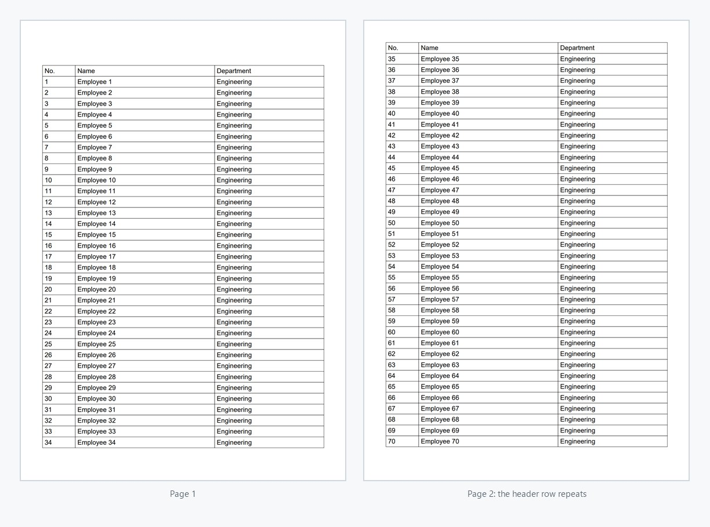

# Tables across pages

[README](../../README.md) · [All guides](README.md) · [Try it live](https://unlimitedpdf.dev/playground/create/tables)

A table that runs past the bottom of the page continues on a new page by itself. Rows are never split, and the new pages are added right after the table's page.

```cs
using UnlimitedPDF;

// Margins apply to every page; both default to 0 (the page edges).
var pdfDocument = new PdfDocument { MarginTop = 40, MarginBottom = 50 };
var page = pdfDocument.AddPage();

var table = page.AddTable(40, 760, 515);
table.SetColumnWidths(60, 255, 200);

// Mark the first row as a header and draw it again at the top of every new page.
table.HeaderRowCount = 1;
table.RepeatHeaderRows = true;
table.GetOrCreateCell(0, 0).Text = "No.";
table.GetOrCreateCell(0, 1).Text = "Name";
table.GetOrCreateCell(0, 2).Text = "Department";

for (int i = 1; i <= 200; i++)
{
    table.GetOrCreateCell(i, 0).Text = i.ToString();
    table.GetOrCreateCell(i, 1).Text = "Employee " + i;
    table.GetOrCreateCell(i, 2).Text = "Engineering";
}

pdfDocument.Save("directory.pdf");
```



- A row taller than the space between the margins, or header rows that cannot fit with one data row, make `Save` throw before anything is written.
- Tables that start on the same page share their continuation pages, so side-by-side tables stay side by side.
- Content you place at coordinates is never moved. To put content after a table, add both to the body flow (see [Headers, footers & flow](headers-footers-and-flow.md)).
