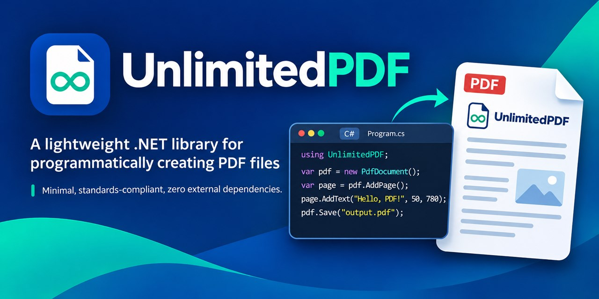



<h3 align="center">UnlimitedPDF Library</h3>

<p align="center">
UnlimitedPDF is an enterprise-grade, pure .NET PDF library for creating PDF documents with text, tables, and JPEG and PNG images, saved to a file or a stream.
</p>

## Status

[](https://www.nuget.org/packages/unlimitedpdf/absoluteLatest)
[](https://www.nuget.org/packages/unlimitedpdf/absoluteLatest)

## Table of contents

### [Install](#install)

- **.NET CLI**
  
  Install with [NuGet](https://www.nuget.org/): `dotnet add package UnlimitedPDF --version 0.1.0`
  
- **Package Reference**
  
  Add package reference to project: `<PackageReference Include="UnlimitedPDF" Version="0.1.0" />`
  
## Sample Code

```cs

var pdfFilePath = @"D:\\unlimited-pdf-sample.pdf";

var pdfDocument = new PdfDocument();

// Add the first page and add content to it.
var page1 = pdfDocument.AddPage();
page1.AddText("UnlimitedPDF library - Sample PDF", 50, 750, 24);
page1.AddText("This is the first line on the first page.", 50, 730, 12);
page1.AddText("This is the second line on the first page.", 50, 710, 12);

pdfDocument.Save(pdfFilePath);
```

### Screenshot


## Create a sample invoice

```cs
using UnlimitedPDF;
using UnlimitedPDF.Enums;
using UnlimitedPDF.Models.Table;

Console.WriteLine("Start: Unlimited PDF");

var pdfFilePath = @"D:\\unlimited-pdf-sample.pdf";

// Use a 'using' statement for proper resource management with IDisposable
var pdfDocument = new PdfDocument();

// --- Page 1: Invoice ---
var page1 = pdfDocument.AddPage();

// 1. Invoice Header
page1.AddText("INVOICE", 250, 800, 20);

// Seller and Buyer Details
page1.AddText("Seller:", 50, 760, 10);
page1.AddText("ABC Electronics Pvt. Ltd.", 50, 748, 10);
page1.AddText("123 Tech Park, Bangalore, KA 560001", 50, 736, 10);
page1.AddText("GSTIN: 222222222222225", 50, 724, 10);

page1.AddText("Buyer:", 350, 760, 10);
page1.AddText("UnlimitedPDF", 350, 748, 10);
page1.AddText("456 Code Street, Hyderabad, TS 500001", 350, 736, 10);

// Invoice Metadata
page1.AddText($"Invoice No: INV-{DateTime.Now:yyyy-MM-dd}-001", 50, 690, 10);
page1.AddText($"Date: {DateTime.Now:dd-MMM-yyyy}", 50, 678, 10);

// 2. Items Table
var itemsTable = page1.AddTable(50, 650, 512);
itemsTable.SetColumnWidths(40, 210, 60, 100, 102);

// Table Headers
var headerRow = itemsTable.AddRow();
headerRow.GetCell(0).Text = "S.No.";
headerRow.GetCell(0).Background = PdfColor.LightGray;
headerRow.GetCell(1).Text = "Item Description";
headerRow.GetCell(1).Background = PdfColor.LightGray;
headerRow.GetCell(2).Text = "Qty";
headerRow.GetCell(2).Background = PdfColor.LightGray;
headerRow.GetCell(3).Text = "Rate (INR)";
headerRow.GetCell(3).Background = PdfColor.LightGray;
headerRow.GetCell(4).Text = "Amount (INR)";
headerRow.GetCell(4).Background = PdfColor.LightGray;

// Item 1
var item1Row = itemsTable.AddRow();
item1Row.GetCell(0).Text = "1";
item1Row.GetCell(1).Text = "Wireless Keyboard";
item1Row.GetCell(2).Text = "2";
item1Row.GetCell(2).HAlign = PdfCellHorizontalAlignment.Right;
item1Row.GetCell(3).Text = "1250.00";
item1Row.GetCell(3).HAlign = PdfCellHorizontalAlignment.Right;
item1Row.GetCell(4).Text = "2500.00";
item1Row.GetCell(4).HAlign = PdfCellHorizontalAlignment.Right;

// Item 2
var item2Row = itemsTable.AddRow();
item2Row.GetCell(0).Text = "2";
item2Row.GetCell(1).Text = "USB-C Docking Station";
item2Row.GetCell(2).Text = "1";
item2Row.GetCell(2).HAlign = PdfCellHorizontalAlignment.Right;
item2Row.GetCell(3).Text = "4500.00";
item2Row.GetCell(3).HAlign = PdfCellHorizontalAlignment.Right;
item2Row.GetCell(4).Text = "4500.00";
item2Row.GetCell(4).HAlign = PdfCellHorizontalAlignment.Right;

// 3. Totals Section
double subtotal = 7000.00;
double cgst = subtotal * 0.09; // 9% CGST
double sgst = subtotal * 0.09; // 9% SGST
double total = subtotal + cgst + sgst;

var totalsTable = page1.AddTable(350, 550, 212);
totalsTable.SetColumnWidths(110, 102);

totalsTable.GetOrCreateCell(0, 0).Text = "Subtotal";
var subtotalValueCell = totalsTable.GetOrCreateCell(0, 1);
subtotalValueCell.Text = subtotal.ToString("F2");
subtotalValueCell.HAlign = PdfCellHorizontalAlignment.Right;

totalsTable.GetOrCreateCell(1, 0).Text = "CGST @ 9%";
var cgstValueCell = totalsTable.GetOrCreateCell(1, 1);
cgstValueCell.Text = cgst.ToString("F2");
cgstValueCell.HAlign = PdfCellHorizontalAlignment.Right;

totalsTable.GetOrCreateCell(2, 0).Text = "SGST @ 9%";
var sgstValueCell = totalsTable.GetOrCreateCell(2, 1);
sgstValueCell.Text = sgst.ToString("F2");
sgstValueCell.HAlign = PdfCellHorizontalAlignment.Right;

var totalCell = totalsTable.GetOrCreateCell(3, 0);
totalCell.Text = "Total";
totalCell.Background = PdfColor.LightGray;

var totalValueCell = totalsTable.GetOrCreateCell(3, 1);
totalValueCell.Text = total.ToString("F2");
totalValueCell.HAlign = PdfCellHorizontalAlignment.Right;
totalValueCell.Background = PdfColor.LightGray;

// 4. Terms and Conditions
page1.AddText("Terms & Conditions:", 50, 450, 10);
page1.AddText("1. Payment due within 30 days.", 50, 438, 9);
page1.AddText("2. Goods once sold will not be taken back.", 50, 426, 9);

pdfDocument.Save(pdfFilePath);

Console.WriteLine("End: Unlimited PDF");
Console.ReadLine();
```

### Screenshot


## Add images

Load a JPEG or PNG once, then place it anywhere on any page, or inside table cells. Each image is stored once in the PDF, however many times it is placed, and one loaded image can be shared by many documents, including documents built in parallel.

```cs
using UnlimitedPDF;
using UnlimitedPDF.Enums;
using UnlimitedPDF.Models.Table;

// Load from a file, a Stream, or a byte array; async loading takes a cancellation token.
var logo = PdfImage.FromFile("logo.png");
var photo = await PdfImage.FromStreamAsync(uploadStream);

var pdfDocument = new PdfDocument();
var page = pdfDocument.AddPage();

// x and y are the image's bottom-left corner, in points from the page's bottom-left corner.
// With no size, images draw at 96 pixels per inch; with one size, the other keeps the aspect ratio.
page.AddImage(logo, 492, 762, width: 70);

// With both sizes the image stretches to fill the box, or fits inside it with Contain.
page.AddImage(photo, 50, 560, 150, 100, new PdfImagePlacementOptions { Fit = PdfImageFit.Contain });

// Lengths are always points; convert from millimeters, centimeters, inches, or pixels.
page.AddImage(photo, PdfUnits.FromMillimeters(20), PdfUnits.FromMillimeters(20), width: PdfUnits.FromInches(2));

// A cell holds an ordered list of text and images, drawn top to bottom.
// AtLeast rows grow to fit their content; Exactly rows (the default) keep their height and shrink images.
var table = page.AddTable(50, 500, 300);
table.SetColumnWidths(100, 200);
table.RowHeightRule = PdfRowHeightRule.AtLeast;
table.GetOrCreateCell(0, 0).SetContent(photo, "Laptop", "SKU 123");
table.GetOrCreateCell(0, 1).Text = "Image above two lines of text";

pdfDocument.Save("images.pdf");
```

- Supported formats: JPEG (baseline and progressive; grayscale, RGB, CMYK) and PNG (every color type and bit depth, interlaced or not, with transparency).
- Photos honor their EXIF orientation. Turn this off with `PdfImageLoadOptions.ApplyExifOrientation = false`.
- Bad input fails at load. Unsupported formats, damaged data, and images over the pixel limit throw `PdfImageException`. The limit is 100,000,000 pixels by default; change it with `PdfImageLoadOptions.MaxPixels` or `PdfImage.DefaultMaxPixels`.

## Changes in 0.1.0

- New: images (`PdfImage`, `PdfPageBuilder.AddImage`), images and stacked content in table cells, row height rules, and unit conversion (`PdfUnits`).
- `PdfTableCell.Text` now reads and writes the cell's first text item; text-only cells behave as before.
- Table cells with `VAlign` set to `Top` or `Bottom` are now drawn that way (it had no effect before).
- Table cell text containing a backslash or an unbalanced parenthesis is now escaped, so it displays as written.
- Table numbers are written the same way in every culture, so documents saved under comma-decimal cultures are valid.
